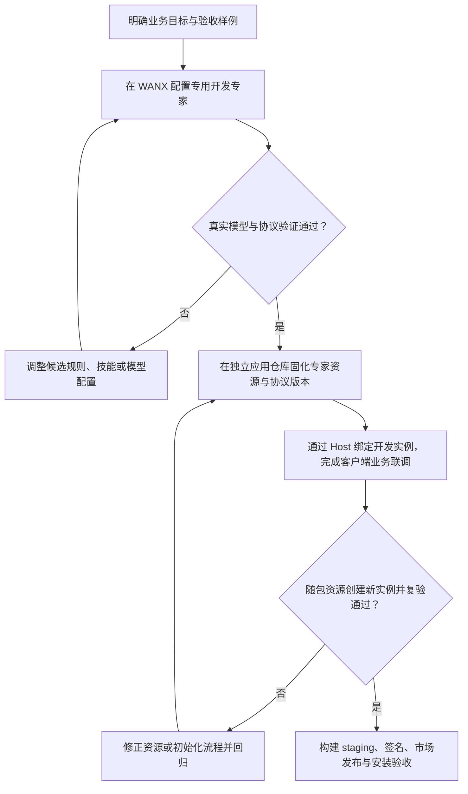
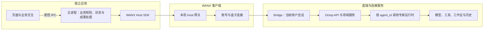
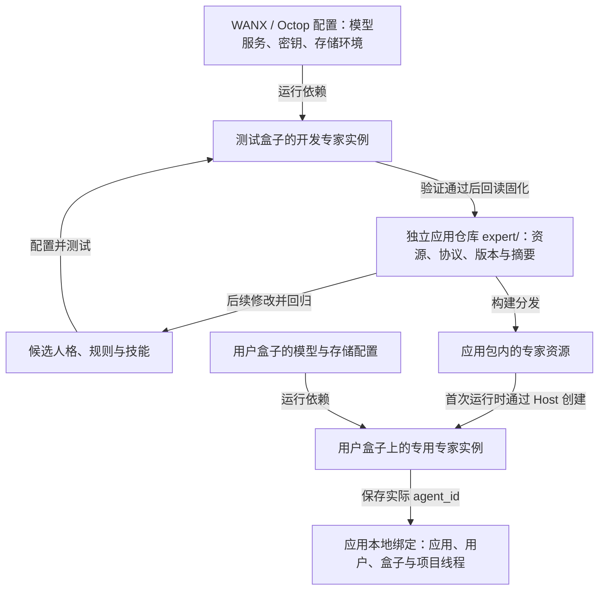
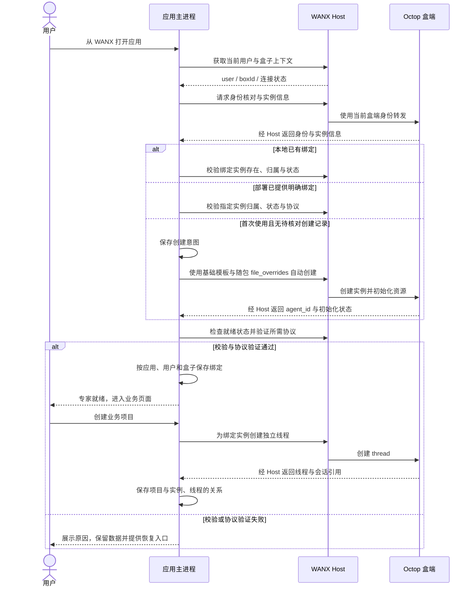
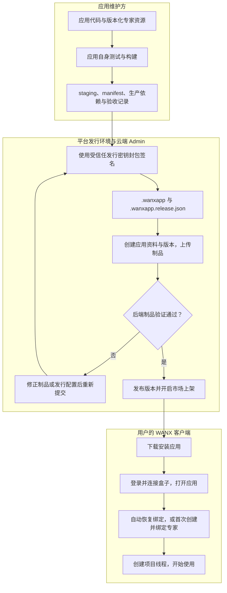

# 专家应用开发指引

本文由 WANX 平台仓库维护，面向独立专家应用开发者及平台维护者。平台接口核对日期为 2026 年 10 月 14 日；应用开发、依赖安装、测试和构建在各自独立仓库进行。文中的 WANX 源码链接供平台核对，不是应用项目的源码依赖。

开发新的专家应用，先确定交付形态：复用 WANX 界面的专家模板，或可从应用市场安装的独立桌面应用。后者可以直接复用 WANX 当前身份下的专家实例，通过 Host 调用 Octop Agent 运行时和基础设施。独立安装不意味着必须建立独立的盒端应用权限域。

默认流程为“WANX 配置开发专家并验证效果 → 独立应用仓库固化资源与协议 → Host 绑定开发实例并完成业务联调 → 用随包资源创建新实例复验 → 打包发布”。应用业务可放在客户端，已有通用能力足够时无需修改 Octop 核心。普通专家应用依次执行第 0–10 节；附录 A–D 仅供需要内置模板或平台扩展时使用。



## 0 开工前取得平台交付物

开始前指定应用负责人、平台接口联系人和发行负责人。平台联系人及交付地址由实际项目填写，本文不假定公开 SDK 下载地址、通用脚手架或公共安装 CLI 已存在。

| 必需输入 | 从谁取得 | 开始相关阶段前的检查 |
| --- | --- | --- |
| 测试账号、盒子和可用模型 | 平台管理员 | 能从 WANX 打开控制台、创建专家并完成一次真实模型调用 |
| Host SDK `.tgz`、类型、校验摘要与使用许可 | 平台维护方 | 版本固定，可作为生产依赖；确认可随应用再分发 |
| HTTP 合同、流事件合同、脱敏样例 | 平台维护方 | 覆盖身份、实例、线程、流式结束、错误、取消、HITL 和恢复；OpenAPI 不替代 WS 合同 |
| 开发版 WANX、可信安装工具及操作说明 | 平台维护方 | 说明安装人员、实际入口、支持系统与共享 Electron 版本，可安装最小制品 |
| 测试签名或正式签名与上架流程 | 发行负责人 | 明确提交位置、制品要求、签名责任和市场发布权限 |

将版本化合同、SDK 校验记录及脱敏样例保存到应用的 `contracts/wanx/`，SDK 包按许可保存到 `vendor/` 或私有制品源。维护兼容清单，分别记录 SDK、WANX、共享 Electron、盒端 API、模型、专家资源与应用业务协议版本，只有实测通过才标为支持。

缺少模型时先完成本地设计与模拟；缺少安装入口时仍可在 WANX 控制台验证专家和开发应用；缺少签名渠道时只能完成 staging。相应缺口必须在进入真实联调或发行前由平台解决，不通过读取平台账号文件或自造认证参数绕过。

完成条件：每项交付有负责人、取得方式和适用版本，能够区分已取得与待取得。本文提供开发步骤与接口基线，完整业务代码和构建脚本由应用项目实现。

## 1 选择开发路径

| 需求 | 选择 | 主要交付 |
| --- | --- | --- |
| 新增角色、工作方法、技能，使用现有聊天和工作区 | 专家模板 | `manifest.json`、人格文件、技能与资源 |
| 独立入口、专用页面、自己的业务流程 | 独立专家应用 | 专家实例绑定、Host 接入、客户端业务、Electron 应用、`.wanxapp` |
| 需要额外限制应用可访问的资源与接口 | 独立应用权限域 | 在前一项上增加产品注册、授权与 scoped token 接入 |
| 多专家协作、主持、讨论控制和成果 | 复用 Teams 的专家应用 | 成员、主持策略、场次状态与恢复；基础能力不足时再扩展盒端 |

专家模板可用于验证专家效果，也可成为独立应用的内容来源；两者目前没有自动绑定。独立应用默认维护自己的专家资源，使用现有基础模板创建实例，无须先把业务专家加入 Octop 内置目录。只需模板的项目完成第 3 节中相应路径和相关验收即可，不必开发桌面壳。

## 2 明确交付边界与标识

先写一页产品说明，确定目标用户、核心任务（建议先选 1–3 个）、输入与输出、所需模型和工具、数据保存位置、首次使用流程、失败状态，以及可验证的验收样例。需要多 Agent 时，说明每个角色的必要性、停止条件和用户介入方式。

以下使用“研究助手”作为示例；标识均为示例值，需在立项时确定并保持稳定。

| 标识 | 示例 | 用途 |
| --- | --- | --- |
| 专家模板 `id` | `research-assistant` | 选择专家目录与种子文件 |
| 盒端产品 `application_id`（可选） | `research-assistant` | 需要独立权限域时使用；普通实例默认属于 `wanx` |
| 桌面包 `applicationId` | `centaurai.wanx.research-assistant` | 安装、启动、更新、市场制品 |
| 运行实例 `agent_id` | 由服务端返回 | 用户私有专家实例，不能写死在发行包中 |
| 对话 `thread_id` | 由服务端返回 | 实例内的具体对话 |

应用通过已绑定的 `agent_id` 调用专家实例，桌面包 ID 用于安装和发行。**普通用户打开应用即可使用对应专家，无须从专家列表中选择。** 应用的专家角色、资源及协议由开发者确定；运行时恢复当前用户和盒子的有效绑定，首次使用且无绑定、无待核对创建记录时，根据随包资源创建专用实例并保存绑定。部署已提供明确绑定时直接校验并使用。

这是应用需要实现的初始化逻辑：当前 Host 负责身份和传输，不会仅凭安装 manifest 自动建立专家绑定。绑定记录应区分用户和盒子，并在使用时重新验证实例可访问性。仅当采用独立权限域时，桌面包 ID 才需要通过平台支持的可信映射关联盒端产品 ID，见附录 B、C。

独立应用的调用链为：



图中为普通专家应用链路。只有附录 C 所述场景增加 scoped 身份，应用仍通过 Host 调用专家。

职责分工：应用负责交互、应用业务及其状态；WANX 客户端负责账号、网络、连接和应用生命周期；盒端负责 Agent 运行、通用存储与权限等基础设施；市场服务负责制品登记与发布。

## 3 配置、验证与固化专家内容

### 配置归属

“在 WANX 配置专家”指在控制台创建和调试盒端运行实例，不表示修改 WANX 平台源码。配置分为以下几类：

| 配置 | 保存位置 | 更新责任 |
| --- | --- | --- |
| 账号、盒子连接、模型服务和密钥、存储环境 | WANX / Octop | 平台或用户管理，不随应用包分发 |
| 开发实例名称、实际 `agent_id`、选定模型与运行状态 | 测试盒子 | 用于效果验证与应用联调；不是发行配置的唯一来源 |
| 人格、工作规则、技能、模板、结构化协议 | 独立应用仓库 `expert/` | 应用维护者版本化，记录内容摘要并随包交付 |
| 用户实际绑定的专家及项目线程 | 应用数据目录 | 按用户和盒子保存，运行时验证归属与可用性 |



资源固化和新实例创建均由开发流程或应用显式执行；图中的箭头不表示平台会自动同步配置。密钥留在平台，发行包不携带开发实例 ID 作为固定绑定。

### 默认路径：先在 WANX 验证

1. 准备产品说明与合成测试材料。在 WANX 中创建专用开发实例，选择可用模型及适合任务的工作区范围；先启用核心任务所需的资源。
2. 配置 `SOUL.md`、`AGENTS.md` 及必要技能，检查配置已保存、实例已就绪。市场专家可作为基础，但必须核对其规则是否兼容目标工作流，不能仅凭模板名称判断。
3. 使用真实模型验证核心任务。对访谈类应用至少检查连续追问、不同选项、自由回答、跳过、修改答案及结束；结构化响应须实际解析并核对版本、请求 ID、修订号、枚举和来源引用。
4. 记录测试输入、完整输出、模型、平台版本、实例与线程 ID、结果和失败样例。模拟响应、欢迎语或创建成功不代表模型效果通过。
5. 将验证通过的实际内容保存到独立应用仓库 `expert/`，记录资源版本、协议版本和摘要。后续按“修改候选资源 → 更新开发实例 → 回归验证 → 固化发行资源”迭代。

开发实例验证通过即可进入应用集成。可以提前建立应用工程和开发模拟界面，但完整业务验收必须依赖真实协议验证；已有应用项目直接补齐此阶段，无须重建。

### 随包资源与新用户初始化

建议资源布局如下。`resource.json` 是应用自行定义的版本元数据，不是 Octop 要求的配置文件：

```text
应用仓库/
  expert/
    resource.json
    SOUL.md
    AGENTS.md
    skills/
    templates/
    protocol/
  contracts/wanx/
  docs/
```

开发联调时，由开发者配置已验证实例的绑定，或使用仅用于开发的绑定入口。面向新用户时，应用负责自动初始化，通过 `GET /api/experts/default` 检查基础模板，再调用 `POST /api/agents/from-expert/default`，用 `file_overrides` 提供随包资源。示例中的正文是占位内容，实现时读取完整版本化文件：

```json
{
  "name": "研究助手",
  "description": "整理材料并形成有依据的研究结论",
  "file_overrides": [
    {"name": "SOUL.md", "content": "应用内完整人格内容"},
    {"name": "AGENTS.md", "content": "应用内完整工作与输出规则"},
    {"name": "skills/research/SKILL.md", "content": "应用内完整技能内容"}
  ],
  "quick_prompts": []
}
```

`file_overrides` 接受受校验的根级 Markdown、`skills/<合法名称>/...` 和 `agents/<合法名称>.md` 等内容，不是任意目录上传接口。`resource.json`、`protocol/`、`templates/` 是应用自己的资源布局，不要整目录原样传给创建接口；只映射所需且受支持的文件。非根级模板可作为技能参考资料放到合法技能路径，应用校验用的 Schema 留在应用侧。工作区文件存在也不代表自动注入提示，需在规则或技能中说明何时读取。

创建后保存实际 `agent_id`，核对 `bootstrap_pending`、运行状态与协议兼容，初始化失败不能标为绑定完成。若使用自定义实例 ID 恢复结果不明的创建请求，应先持久化创建意图并核对归属；自定义 ID 不等于通用幂等键，超时不能盲目重建。

发行前，用随包资源创建另一个新实例并重复关键测试，证明配置可复现。开发者的实例 ID 不写死在安装包中；应用在用户自己的盒子上创建并绑定对应专家，普通用户无需手工选择。提示词不兼容的改动需同步更新协议版本、客户端校验和兼容测试。基础 nonce 探测只证明对应探测响应，不代表完整业务协议可用。

## 4 建立独立应用工程

在独立仓库初始化 Electron 工程；页面框架由应用选择，本文不要求 React。共享运行时模式下，应用仍是独立子进程。目标 Node/Electron 版本以平台交付为准；当前 SDK 0.2.0 要求 Node.js 22 或更高，开发机版本满足要求也不能替代目标共享运行时测试。

建议目录职责如下，已有项目按职责映射即可：

```text
应用仓库/
  shell/                 主进程、preload、受控 IPC
  src/                   页面、业务领域、Host 与存储适配
  expert/                人格、规则、技能、协议与模板
  contracts/wanx/         接口快照、事件样例与兼容记录
  vendor/                获准再分发的 SDK 制品
  tests/                 业务、合同、恢复与桌面测试
  tools/                 构建、资源收集、staging 生成
  docs/                  产品说明、开发、验收与发行记录
  package.json
  package-lock.json
```

取得文件名匹配的 SDK 后，在应用根目录安装并固定生产依赖：

```sh
npm install --save-exact ./vendor/centaurai-wanx-host-sdk-0.2.0.tgz
```

应用自行实现下列脚本。它们是项目需提供的入口，不是安装 SDK 后自动生成的命令，也不从其他应用复制私有实现：

| 脚本 | 责任与完成条件 |
| --- | --- |
| `dev` | 启动页面与桌面开发环境；无 Host 时明确使用测试 fixture，不伪装真实连接 |
| `typecheck`、`lint` | 校验应用类型和静态规则；非 TypeScript 工程使用等价检查 |
| `test` | 执行业务与合同测试，使用固定脱敏样例 |
| `build` | 生成可运行的主进程、preload 和页面产物 |
| `prepare:application` | 收集产物、专家资源、`package.json` 与全部生产依赖，生成 staging |
| `test:desktop` | 从 staging 启动桌面制品并检验核心操作；区分 fixture 与真实 Host |

准备脚本分别输出 `staging/development/` 开发目录和 `staging/market/` 市场目录，根清单分别为 `application.manifest.json`、`wanx-app.json`；从同一份应用元数据生成，保持 ID、版本、入口一致。脚本可以使用本项目约定的参数选择目标，并将实际命令写入 README。入口路径相对于 staging 根目录，必须匹配真实编译产物。

完成这些脚本后，干净检出应可按以下顺序执行；发行前确认生产依赖没有指向本机平台仓库的路径或符号链接：

```sh
npm ci
npm run typecheck
npm run lint
npm test
npm run build
npm run prepare:application
npm run test:desktop
```

完成条件：另一台开发机按锁文件构建出相同内容的 staging，脱离源码目录能解析入口及生产依赖，并能由目标运行时启动。此时不要求真实 Host 联调已经通过。

## 5 打通身份、专家与项目线程

本文的“项目”指应用的业务工作单元；没有项目概念的应用可映射为任务或会话，并为每个独立工作单元保存相应线程。

以下路径通过应用主进程的 Host SDK 调用；以平台交付的目标版本合同核对请求体、响应字段与错误码。应用不自己连接真实盒子地址。

| 顺序与条件 | 方法或接口 | 应用处理 |
| --- | --- | --- |
| 启动 | `host.context()`、`GET /api/auth/me` | 校验当前用户、盒子和连接状态 |
| 恢复绑定 | `GET /api/agents/{agent_id}` | 使用当前用户、盒子的已保存或明确部署的绑定，校验实例归属与可用性 |
| 开发调试或高级重绑（可选） | `GET /api/agents?scope=mine`、`GET /api/agents/{agent_id}` | 列表可能含共享实例；核对归属与协议，不作为普通用户首次使用的必经页面 |
| 首次自动初始化 | `GET /api/experts/default`、`POST /api/agents/from-expert/default` | 按第 3 节提交资源并保存创建意图与结果 |
| 就绪检查 | `GET /api/agents/{agent_id}`、`GET /api/agents/{agent_id}/status` | 检查初始化及运行状态；需要启动时调用 `POST /api/agents/{agent_id}/start` |
| 新业务项目 | `POST /api/agents/{agent_id}/threads` | 无须请求体；保存返回的 `thread_id`、`session_key` |
| 发起或续聊 | `host.openStream('/api/agents/{agent_id}/chat/ws')` | 使用实际 ID 拼接路径，等待连接打开后发送消息 |
| 恢复 | `GET /api/agents/{agent_id}/threads/{thread_id}/history` | 按合同读取历史并核对在途轮次 |
| 工具审批暂停 | `POST /api/agents/{agent_id}/chat/hitl/resume` | 按目标合同展示审批并由用户决定；处理恢复流 |

`start` 成功可返回 204，无 JSON 响应体；通用请求封装应先检查 HTTP 状态，不能对所有成功响应直接调用 `.json()`。实例状态检查设置合理超时并显示恢复入口，不无限等待。

自动初始化仅适用于首次无绑定的状态。已有绑定失效时保留业务数据并进入恢复流程；有未完成创建记录时先核对原实例，不能将超时、权限问题或绑定丢失都当成首次使用。若缺少模型配置或资源权限，显示具体原因和平台配置入口，不让用户通过任意选择另一个专家掩盖初始化失败。

创建线程会改变该专家的 Dashboard 当前线程，因此优先绑定专用开发或应用专家。应用每轮始终显式传入项目线程 ID，不依赖服务端当前线程。若允许共享实例，需额外验收共享访问、创建线程及工具权限，不能仅凭列表可见认定全流程可用。

### 首次真实调用

通过 SDK 的 `openStream` 得到连接后立即注册 `open`、`message`、`error`、`close` 监听器；在 `open` 时发送以下消息，替换所有示例 ID：

```json
{
  "type": "user_turn",
  "thread_id": "实际项目线程ID",
  "session_key": "创建线程返回的会话键",
  "text": "本轮用户任务及必要业务上下文"
}
```

`session_key` 是会话路由标识，不是认证 token；凭证仍由 Host 托管。取消发送 `{"type":"cancel","thread_id":"实际项目线程ID"}`；重连订阅发送 `{"type":"subscribe","thread_id":"实际项目线程ID"}`。订阅返回 `turn_status`，不保证重放断线期间全部文本。连接关闭不等于远端任务已取消。

入站事件按平台交付的完整合同解析，至少区分文本、工具、错误、结束、暂停和轮次状态。不能仅收到 `done` 就认定业务成功：错误也可能以结束事件收尾。客户端业务请求 ID 与盒端事件字段分别处理，不假定盒端原生理解自定义 JSON 中的请求 ID。

完成条件：从 WANX 启动应用，在同一绑定专家与项目线程连续完成两轮真实调用；另一项目使用不同线程；输出和错误均能被适配层识别。实例绑定和生命周期实现见下一节。

## 6 实现业务与桌面客户端

### 应用业务与盒端基础设施

优先复用聊天、记忆、知识库、上传、模型和 Teams。专家负责理解材料、推理和生成内容建议；访谈类任务还包括选择追问和生成选项。客户端负责页面交互、输入保存、结果校验及业务状态；确认、进展和导出按应用需求实现。需要新增盒端通用能力时，由平台维护方在 `infra/` 实现领域规则，API 负责校验输入和映射错误。应用侧提交接口需求、复现样例与验收条件，等待可用版本后接入。客户端通过 API 使用盒端能力，不直接读取盒端数据库或用户工作区。

应用使用已有工作区 HTTP 接口访问盒端文件，不导入 Python 的 `BackendWorkspace`。只有修改盒端的平台维护者需要遵循该存储抽象、数据库迁移及后端 i18n 规范。应用页面维护自己的语言资源；显示盒端时间及调度默认值时，通过 `GET /api/settings/timezone` 获取服务器时区。

多专家应用还需定义主持策略、场次状态、暂停继续、用户插话、重复回调处理、重启恢复与成果归属。不要仅用一段提示词代替可验证的业务状态。

### 业务协议与持久化

若应用只展示自然语言回复，可以保留文本输出；若输出会驱动选项、表单或状态变更，定义版本化的业务 Schema，并保存成功、错误、过期及不完整输出的样例。JSON 提示词约定不等于模型强制遵守 Schema，完整响应通过类型、枚举、请求关联和业务引用检查后才能应用。

将用户输入、模型建议和已提交业务状态分开保存。模型建议涉及用户确认时，以客户端真实操作产生确认记录。对同一项目串行提交状态变更，过期与重复响应不得覆盖新状态；格式修复设置次数上限，失败保留原始输入并允许用户重试。

业务数据写入 WANX 为应用提供的 Electron userData，进一步按用户与盒子分区，不存放在安装目录。采用事务或临时文件原子替换，保存必要修订与恢复快照。发送前落盘请求意图，成功后将结果和已提交标识一并持久化；聊天历史不代替应用自己的业务数据。

默认绑定改变只影响新项目。实例删除、停机或权限失效时保留本地数据并显示恢复方式；项目迁移到另一个专家应显式建立新线程并携带必要业务快照。卸载应用不自动删除盒端专家、线程或资料。是否支持备份、跨设备迁移及离线查看由应用明确声明并验证，不从盒端保存历史推导已具备这些能力。

### 桌面入口与 SDK

新应用可维护独立代码库。首版优先使用共享 Electron 运行时；需要自带运行时时再选择 `bundled`，并完成平台构建和生命周期接入。

当前 Host SDK 在 `wanx-client/host-sdk/`，版本为 `0.2.0`，包名为 `@centaurai/wanx-host-sdk`。由平台维护方通过 `npm pack` 交付 `.tgz`、类型、版本和校验摘要，应用将其安装为生产依赖并固定锁文件；不引用平台源码的相对路径或符号链接。它提供传输和生命周期，业务 API 由应用自己调用。平台同时交付 HTTP 与流式事件合同、脱敏样本、开发运行环境和可信安装方法。

主进程接入顺序：

1. 用 `fromEnvironment()` 获取 Host；Host 模式缺失或协议不支持时给出明确启动错误。
2. 注册 `onSessionInvalidated`，清空内存中的旧身份、会话和页面数据，关闭聊天连接；保留已落盘的业务数据。
3. 调用 `host.context()` 初始化事件通道；用 `/api/auth/me` 验证业务身份。
4. 恢复并校验当前身份下的明确绑定；首次使用且没有绑定或待核对创建记录时，用随包资源创建专用实例。保存并验证 `agent_id` 后直接进入业务页面，不要求普通用户选择专家。采用独立权限域时，才走相应的应用 profile 流程。
5. 通过 `host.request()` 发送 HTTP 请求，通过 `host.openStream()` 使用聊天 WebSocket；HTTP 返回标准 `Response`，需检查状态。

绑定以应用、用户和盒子为范围，记录实例 ID、资源版本、协议验证结果和来源。应用声明绑定的是专家角色和资源版本，具体 `agent_id` 属于运行环境，不将开发盒子的 ID 固定给所有用户。开发调试、部署预绑定或高级重绑涉及现有实例时，校验实际归属与协议，不通过同名匹配自动绑定，也不自动覆盖其配置。每个业务项目保存自己的 `agent_id`、`thread_id` 和必要会话引用；切换默认专家只影响新项目。独立线程不隔离专家级工作区与记忆，跨项目资料使用必须有明确规则。



renderer 通过受控 IPC 或应用本地服务访问业务，不接触 `WANX_HOST_TOKEN`。上传保留 multipart boundary，大文件使用流；聊天连接立即注册事件监听并处理取消。

`bundled` 应用必须在单实例锁和创建窗口之前调用 `@centaurai/wanx-host-sdk/electron` 的 `attachElectronHost()`。共享运行时由 WANX 处理相应就绪与唤起事件。资源路径使用 `import.meta.url` 或应用启动目录，不假设 `app.getAppPath()` 指向业务包。

临时网络中断显示恢复状态，不自动重发写操作；切换盒子、退出账号或 Host 会话失效后，提示回 WANX 重新打开，不能沿用旧会话或自动转向另一盒子。

接入细节与示例见 [Host 应用接入](wanx-host-app-integration.md)。该文档由平台随 SDK 一并交付，业务项目不依赖其中其他应用的源码示例。

## 7 联调与验收

建议按五个里程碑推进，各阶段分别记录真实验收结果：

| 阶段 | 交付 | 通过标准 |
| --- | --- | --- |
| 专家效果 | WANX 开发实例、候选规则与核心技能 | 用真实模型完成约定任务；对结构化响应实际解析并检查多轮行为 |
| 资源固化 | 独立应用仓库的专家资源、协议与版本摘要 | 配置可复现，测试输入输出可追溯，兼容策略明确 |
| 最小接入 | Host 连接、专家实例绑定、一次聊天 | 正确用户与盒子、稳定实例、真实流式响应；采用独立权限域时另验证 scoped 身份 |
| 完整业务 | 专用界面、资料与业务流程、失败处理 | 主流程、取消、恢复、隔离及数据持久化通过 |
| 可发布包 | 随包专家资源、构建目录、签名包、更新与回退方案 | 随包资源创建新实例复验通过；实机安装启动、升级、保留用户数据、显式回退通过 |

开发安装由平台提供的未打包 WANX 环境设置 `WANX_ALLOW_DEVELOPMENT_INSTALL=1`，通过可信控制面调用现有安装 IPC；该 IPC 不是普通应用可直接调用的 Host SDK 方法。正常页面不提供开发安装按钮。开发目录默认读取 `application.manifest.json`；市场封包读取 `wanx-app.json`，两者保持相同的身份、版本和入口。操作入口以第 0 节取得的说明为准，不能仅靠设置环境变量就认为具备安装工具。

独立应用在自己的仓库执行类型检查、协议与业务测试、构建及桌面验证，命令按第 4 节落地。平台源码变更的检查见附录 D，不是应用 CI 的默认依赖。

### 开发安装操作与完成条件

1. 按第 4 节生成 `staging/development/`，确认根目录有 `application.manifest.json`，其入口、页面、专家资源及生产依赖均存在。
2. 将 staging 的绝对路径交给平台交付的可信安装工具或指定安装人员。内部 `applications-install` 接受 `{sourceDir: "绝对目录"}` 或 `{archivePath: "ZIP绝对路径"}`，二选一；具体工具入口和用法必须随开发环境交付。
3. 由该工具在允许开发安装的环境中安装，或使用平台提供的测试签名发行渠道。没有可信安装入口时，记录缺少的交付物并由平台补齐；不能从普通应用 renderer 调用私有控制 IPC，也不能将本地模拟标为真实 Host 验收。
4. 从 WANX 应用列表打开应用，核对实际用户与盒子，验证应用直接使用开发者已配置的专家绑定。创建两个项目，各完成两轮真实调用，确认各自使用固定但不同的线程。
5. 关闭并重新打开，验证绑定与业务数据恢复；断流后核对状态，切换账号或盒子后不显示旧身份数据。修改主进程或资源后重新构建、递增版本并安装，旧安装不自动读取新源码。
6. 在无绑定的测试用户或应用数据环境下，验证首次打开能用随包资源自动创建并绑定专用专家，无需显示专家选择页；重复打开复用原实例，不重复创建。重复核心任务和协议测试，将开发实例联调与全新实例初始化分别记录。

完成条件：能够从 WANX 启动安装后的制品，在正确身份下调用目标专家，并有实际响应及恢复记录。仅能运行 `npm run dev`、启动模拟盒子或成功安装制品，不等于完成此阶段。

验收记录需区分自动化模拟与真实环境：真实账号、目标盒子、实际模型、目标操作系统、共享或独立运行时分别记录。通用验收至少覆盖首次安装、重复打开、退出重开、切换账号或盒子、网络恢复、权限失效、升级保留数据和回退兼容；有上传、工具审批或独立权限域时，再增加相应取消、审批及越界用例。没有测试的平台不能标为已支持验收。

### 验收记录的最低内容

每次验收保存：应用版本与源提交、SDK/WANX/盒端/运行时版本、操作系统、模型、专家资源摘要、业务协议版本、用例输入、预期结果、实际结果及证据位置。身份和实例使用可追溯的测试标识，凭证及真实用户资料不进入报告。

结果使用“通过 / 失败 / 未执行”，区分模拟、真实开发安装和真实市场安装。任何未执行的必需项都不能作为已完成发布验收；失败记录修复版本和复测结果。

## 8 构建签名与市场发布

### 准备发行目录

先在独立应用仓库完成自身构建，再准备仅包含运行所需内容的 staging 目录：Electron 入口、页面构建结果、本地业务服务、专家资源、`package.json`、生产依赖和 `wanx-app.json`。`package:application` 只封包和签名，不构建应用，也不会自动完成 Host 接入。

共享运行时市场清单示例：

```json
{
  "applicationId": "centaurai.wanx.research-assistant",
  "name": "研究助手",
  "version": "1.0.0",
  "protocolVersion": 1,
  "runtime": "electron",
  "launchMode": "shared",
  "entrypoint": "shell/main.cjs",
  "capabilities": ["identity.read", "http.request", "chat.stream", "files.upload"],
  "description": "研究助手应用"
}
```

清单的 `protocolVersion: 1` 是应用包协议，与 Host 的 `http-v1` 及自定义专家业务协议分别版本化。能力列表按实际使用填写，示例中的 `files.upload` 仅用于有上传功能的应用；当前它是发行元数据，不构成接口权限隔离。

通用包只包含跨平台代码与资源，不设置 manifest 的 `platform` 和 `arch`。含原生依赖时按实际目标构建并指定平台与架构。市场封包拒绝符号链接和特殊文件，不要把开发安装器对链接的支持当作市场包也支持。

### 封包签名

应用维护方交付 staging、源提交号、应用及资源版本、兼容清单和验收记录，平台发行环境负责封包签名。当前封包命令位于 WANX 平台仓库，不假定已有供独立项目安装的公共 CLI；平台若交付独立工具，再固定其版本与合同。

以下命令供平台发行人员在 WANX 仓库执行，路径和版本为占位示例。最低 WANX 版本应选包含应用所需 Host 能力的已发布版本，盒端 API 与模型兼容性另外记录：

```sh
npm --prefix wanx-client run package:application -- \
  --source /absolute/build/research-assistant \
  --out /absolute/release/research-assistant \
  --key /secure/wanx-release-private.pem \
  --key-id release-2026 \
  --min-wanx-version 0.1.1 \
  --build-id ACTUAL_GIT_COMMIT
```

产物为 `.wanxapp` 与 `.wanxapp.release.json`。正式发行使用与 WANX 固定信任根匹配的 Ed25519 发行密钥；私钥和输出目录必须位于打包目录之外。使用新密钥前，先发布信任新公钥的 WANX。平台签名与公证另按目标系统要求完成。

### 上架顺序



1. 核对目标 Octop、Bridge 和 WANX 版本是否已有所需能力；只有存在平台改动时才先发布这些改动。
2. 确保应用能自动恢复有效绑定或首次创建对应专家，普通用户不需要选择专家。采用独立权限域时，另完成产品注册、资源绑定、部署启用和用户开通。
3. 在云端 Admin 创建应用资料和版本，上传应用包与签名旁文件。
4. 等待后端验证成功，发布版本，再编辑应用资料开启“在应用市场上架”。
5. 用目标用户从市场安装，连接盒子，验证首次启动和真实业务。

盒端 `/api/admin/applications/{id}/releases` 是另一套外部安装包元数据接口，不会自动把应用发布到 WANX 在线市场。市场使用云端 `/app-api/market/...` 接口。两边的应用记录、授权和发行状态不能相互替代。

当前 DMG/EXE 可以登记，但市场不会执行原生安装器；第一条发行路径应使用受支持的 `.wanxapp`。完整规则见 [应用市场开发与发布](wanx-application-market.md)。

## 9 升级与维护

应用版本使用严格 SemVer。递增版本发布更新；仅修改 buildId、重新上传同版本或增加构建标签不会成为正常升级。

分别记录应用版本、业务数据格式、专家资源、业务协议及平台兼容版本。升级资源不自动覆盖用户已修改的专家；可保留旧实例并显式创建新版，迁移项目时核对兼容性。

新版准备成功后，下次打开应用才停止旧进程并切换。首次启动失败不会自动回退；用户可以显式回退保留的上一份签名安装。因此应用业务数据迁移应兼容回退，或在发布前明确不可逆边界。

应用程序目录与业务数据目录分离，默认卸载保留业务数据。应用仍需按账号隔离本地缓存，切换账号时不能展示前一用户的数据。

分别制定三种更新策略：桌面程序版本更新、盒端业务及数据库更新、既有用户专家内容更新。修改库中的模板或产品 `agent_template` 不会自动升级已有用户的人格文件、技能和记忆；迁移时保留用户修改并验证幂等性。

交付记录包含应用和模板标识、依赖版本、支持平台、制品与签名、变更说明、测试证据、数据迁移与回退办法。独立应用采用自己的分支与 CI 规则；修改 WANX 平台时才遵守平台仓库的 `develop` 集成流程。提交和推送按项目授权执行。

## 10 开发任务拆分清单

- 产品：确定用户任务、应用形态、模板与包标识、实例绑定方式、输入输出和验收样例。
- 专家：先在 WANX 创建开发实例并用真实模型验证，再在独立应用仓库固化提示、人格、技能、协议与资源版本；验证随包初始化可复现。
- 平台：验证既有 Host 和专家能力；需要独立权限域时才扩展身份映射与兑换。
- 后端：仅在现有基础设施不足时扩展领域服务和 API，完成数据归属、迁移和接口说明。
- 客户端：完成 Host SDK、专家实例绑定、应用业务与状态、专用页面、流式交互和失效处理。
- 测试：覆盖真实业务、用户与盒子数据隔离、连接生命周期及目标平台安装升级；采用独立权限域时才增加跨应用拒绝测试。
- 发行：准备构建目录、签名包、依赖版本、市场资料与上线回退记录。

先完成开发专家效果验证和资源固化；随后第一个应用接入里程碑应证明正确用户与盒子、正确专家实例和一次真实业务响应。发行前再证明随包资源能创建可用的新实例，避免仅在开发者现有专家上运行成功。

## 附录 A 平台维护：加入 Octop 内置专家目录

只有决定由平台内置并随 Octop 版本分发专家时，才在 `src/octop/infra/agents/experts/library/research-assistant/` 创建目录。最小内容为 `manifest.json` 和 `SOUL.md`；其余按任务需要增加：

```text
research-assistant/
  manifest.json
  SOUL.md
  AGENTS.md               可选，工作流程和工具使用规则
  BOOTSTRAP.md            可选，首次引导
  skills/                可选，任务技能及脚本和参考资料
    research/
      SKILL.md
  agents/                可选，子代理定义
```

可参考现有 `zhijun-personal-companion` 的人格与欢迎卡片，以及 `news-trend` 的技能目录。不要整包复制其他专家的业务规则和历史资料。

最小 manifest 示例：

```json
{
  "id": "research-assistant",
  "label": {"zh": "研究助手", "en": "Research Assistant"},
  "description": {"zh": "整理材料并形成有依据的研究结论", "en": "Research with traceable evidence"},
  "welcome_message": {"zh": "你想研究什么问题？", "en": "What would you like to research?"},
  "icon_name": "search",
  "color": "#526D82",
  "prompt_files": ["SOUL.md"]
}
```

需要欢迎卡片时添加 `quick_prompts`，需要任务建议时添加 `task_examples`，字段格式参考现有模板。显示文案提供 `zh`、`en` 两套。

`SOUL.md` 应写清角色、能力范围、如何使用证据、如何处理不确定性和输出要求。技能定义具体任务步骤、工具前提与验证方法。模板中不放账号、密钥或真实用户资料。

### 内置模板的加载与初始化

`ExpertCatalog` 扫描专家目录，通常在服务启动时加载。新增模板后重启开发服务，再通过 `GET /api/experts` 和 `GET /api/experts/{expert_id}` 检查目录、描述及文件预览。

在 WANX 身份下，通过现有界面或 `POST /api/agents/from-expert/{expert_id}` 创建实例。这个接口用于专家模板路径，不能当作任意独立应用的 profile 接口。

创建流程设置 `template_name`，通过 `BackendWorkspace` 写入种子文件；模板 manifest 写入实例的 `.octop/manifest.json`。目录内其他文件会被发现并复制，因此开发缓存、临时产物和私有文件都不应放进专家目录。

`prompt_files` 主要是界面预览元数据，不等于自动把任意 Markdown 注入模型提示。人格文件的实际读取遵循运行时约定；新增自定义文件必须明确由技能或运行时如何读取。

验收：新建实例能完成产品说明中约定的核心任务；工具真实可用；欢迎文案正确；工作区初始化正确。修改模板不会自动更新已有实例，既有用户的内容升级需要单独策略。

源码入口：[catalog.py](../src/octop/infra/agents/experts/catalog.py)、[AgentManager](../src/octop/infra/agents/manager.py)、[专家 API](../src/octop/api/routers/experts.py)。

## 附录 B 平台扩展：产品注册与用户开通

只有采用独立应用权限域时，才需在目标盒子注册产品、配置资源、启用部署并开通用户。普通专家应用沿用 WANX 当前用户权限，通过第 3 节的自动初始化或明确部署绑定获得 `agent_id`，可跳过附录 B、C。云端市场上架仍是单独的发行流程。

管理调用使用 WANX 身份及 `applications_manage` 权限，或 `applications_develop` 权限管理自己创建的产品。产品自身的 scoped token 不用于管理产品注册信息。

按以下顺序调用，路径均包含 `/api` 前缀：

| 顺序 | 接口 | 验收 |
| --- | --- | --- |
| 1 | `POST /api/admin/applications` | 产品存在，模板与能力声明正确 |
| 2 | `PUT /api/admin/applications/{id}/deployment` | 资源引用校验通过，`enabled: true` |
| 3 | `PUT /api/admin/applications/{id}/access` | 目标用户 `enabled: true` |
| 4 | 使用附录 C 的应用身份链路 | `/api/auth/me` 返回期望的 `application_id` |
| 5 | `GET /api/applications/{id}/profile` | 查找当前用户的应用实例 |
| 6 | 实例不存在时 `POST /api/applications/{id}/profile` | 返回稳定的 `agent_id`，重复初始化不产生多余实例 |

产品注册示例：

```json
{
  "application_id": "research-assistant",
  "name": "研究助手",
  "description": "面向资料整理和研究任务的私有助手",
  "capabilities": ["chat", "knowledge", "upload"],
  "agent_template": {
    "name": "我的研究助手",
    "system_prompt": "根据用户提供的材料开展研究，区分事实、推断和待验证信息。",
    "welcome_message": "你想研究什么问题？"
  },
  "resource_requirements": {
    "default_model": {"kind": "model", "required": true}
  }
}
```

部署体为 `{"enabled": true, "resource_bindings": {"default_model": "实际供应商/实际模型"}, "configuration": {}}`，模型引用必须在盒端存在且可用。开通体为 `{"user_id": 目标用户整数ID, "enabled": true}`，其中用户 ID 为占位说明，调用时替换成数字。

当前注册能力包括 `chat`、`memory`、`knowledge`、`upload`、`voice`、`teams`、`zhijun_context`、`brainstorm`、`model_settings`。声明后还要满足对应 API 白名单、资源归属和账号权限；例如模型设置仍检查账号的供应商管理权限。

### 通用 profile 的现有限制

`agent_template` 当前只接受字符串字段 `name`、`description`、`default_model`、`system_prompt`、`welcome_message`。不能加入 `expert_id`、`template_name`、`skills` 等字段并期待自动生效。

通用 `create_profile` 使用上述配置创建私有 Agent，没有自动读取附录 A 的专家目录。需要完整人格文件、技能或特殊初始化时，应由平台维护方在 `infra/` 的实例创建流程增加明确的模板绑定与初始化实现，复用现有 AgentManager 和 workspace 能力。知君及超级参谋已有专门初始化分支，可参考其模式，但不要复制其业务特例。

`resource_bindings` 当前会校验 model、provider、storage、skill、plugin 引用；通用 profile 创建主要消费模型绑定。登记 skill/plugin/storage 不代表它们已自动装配进运行时，项目必须核对实际消费路径并补齐验收。

产品模板更新只影响后续创建的实例。应用内多 Agent 或团队应明确主入口绑定；`teams` 模式需要专门验证重复创建、并发初始化和主入口稳定性。

源码入口：[产品模型](../src/octop/infra/applications/models.py)、[ApplicationService](../src/octop/infra/applications/service.py)、[产品 API](../src/octop/api/routers/applications.py)。

## 附录 C 平台扩展：独立应用身份与数据隔离

这一节仅适用于独立权限域。`client.mjs` 对普通应用不设置 `applicationScope`，直接复用当前盒端连接；这不影响按 `agent_id` 调用有权访问的专家实例。超级参谋额外使用以下身份收窄链路：

```text
桌面包 ID
  → client.mjs 中的 applicationScope 映射
  → gateway.mjs 请求 /api/auth/platform/application
  → Bridge 校验父会话并兑换应用会话
  → Octop /api/auth/application/exchange
  → 校验产品部署和用户开通，签发 scoped token
```

当前以下四处的 scoped 链路仅接入超级参谋；新产品若需要同类权限域，才需要协同扩展并测试：

| 位置 | 当前约束 | 平台维护方需要的工作 |
| --- | --- | --- |
| `wanx-client/client.mjs` | 仅将超级参谋包 ID 映射为 `super-advisory` | 建立新包 ID 与产品 ID 的可信映射 |
| `wanx-client/octop/gateway.mjs` | scoped authorization 只接受 `super-advisory` | 接受受支持产品并保留令牌缓存、续期和父会话校验 |
| `wanx-bridge/wanx_bridge/auth.py` | 应用会话只允许 `super-advisory` | 扩展兑换范围，保留父会话撤销和有效期约束 |
| `src/octop/api/routers/auth_application.py` | 请求及响应模型使用 `Literal["super-advisory"]` | 扩展合同，同时保留产品启用、用户授权和签名校验 |

当前没有映射的桌面包不会自动获得其同名产品的身份。不能把“成功调用某个 `/api`”当作隔离成功；必须检查 `/api/auth/me` 的 `application_id`，并做跨应用拒绝测试。

应用代码不自行向 Host 提交认证兑换、不透传盒端 JWT、不通过 `X-Application-Id` 等自定义头选择权限域。Host 托管认证路径，只向应用主进程提供本次启动的本机临时凭证。

两种 capability 配置必须区分：盒端产品的 `chat`、`knowledge` 等参与 API 访问限制；桌面 manifest 的 `http.request`、`chat.stream` 等是发行元数据，当前 Host 不按该字段执行能力隔离。

新增业务接口时，同步检查 `application_access.py` 的能力与路由白名单、领域层的应用归属和用户归属。跨应用读取应有独立领域服务明确校验访问范围；不能因为同一个登录账号，就直接读取另一应用的全部记忆或知识库。

验收至少包括：未开通用户拒绝、禁用产品后旧会话失效、跨用户与跨应用资源拒绝、管理员角色的应用会话也不能越界、已打开的聊天流在撤销后停止访问。

源码入口：[Host 映射](../wanx-client/client.mjs)、[网关](../wanx-client/octop/gateway.mjs)、[Bridge](../wanx-bridge/wanx_bridge/auth.py)、[兑换接口](../src/octop/api/routers/auth_application.py)、[API 权限](../src/octop/api/common/application_access.py)。

## 附录 D 平台源码变更的验证

以下命令仅供修改 WANX 平台或内置专家的维护者按改动范围执行，工作目录为 WANX 仓库：

```sh
# 专家内容与创建
uv run pytest tests/unit/agents/test_expert_catalog.py tests/integration/test_experts_api.py -q

# 产品、隔离与身份兑换
uv run pytest tests/integration/test_applications.py tests/integration/test_application_isolation.py tests/unit/api/test_application_exchange.py tests/unit/api/test_application_access.py tests/unit/api/test_application_sessions.py -q

# Bridge 与客户端不包含在普通后端测试入口中，需分别运行
npm run test:bridge
npm --prefix wanx-client test
npm --prefix wanx-client run build:renderer

# 代码交付门槛
make all PYTEST_JOBS=4
```

修改 Dashboard 时增加 `cd dashboard && npx tsc -b` 和 `make build-frontend`；涉及 i18n 时运行 `uv run pytest tests/unit/i18n -q`；修改 API 后检查 `/api/docs` 的摘要、请求和响应模型。
