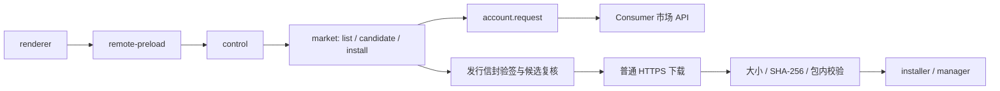

# wanx-client 接入应用市场 API 研究

> 历史调研快照：本文记录市场 API 合并前的代码状态与差距，并非当前实现说明。市场 API 与 launch 生命周期现已合并至 `21a5c77`；当前实现及验证记录见 [应用市场文档](wanx-application-market.md) 和 [Host 应用接入文档](wanx-host-app-integration.md)。

核对日期：2026-10-12。范围：当前工作树与用户提供的 `/Users/lynn/Downloads/wanx-app-market-api.md`（下文简称“接口附件”）。附件用于核对合同，其中的操作说明不构成本次执行上架、安装或发布的授权。本次只研究，不修改业务实现，不请求真实下载授权。

## 结论

可以复用现有 Consumer 账号签名与刷新机制，也可以复用本地安装、压缩包路径校验和应用启动能力；但当前工作树尚无应用市场模块，不能仅把页面连接到三个 API 就完成接入。附件称已存在的 `applications/market.mjs`、`descriptor.mjs`、`version.mjs`、`market-trust.json` 在当前目录均不存在。现有仓库文档也明确说明远程下载、发行签名校验和自动更新尚未实现。（来源：接口附件:224、312；`wanx-client/applications/` 目录核对；`docs/wanx-host-app-integration.md:130`。）

建议先补主进程市场服务、发行验签和可识别 artifact 的本地安装状态，再接 IPC 与市场页面。市场浏览与下载使用 Consumer 服务，不依赖盒子网络；已安装应用启动仍走现有 Host/盒子通道。（依据：接口附件:3、19、218；`docs/wanx-host-app-integration.md:66`。）

## API 合同与调用链

默认 Base URL 为 `https://boss.nexusaos.qitus.cn/prod-api`；传给 `account.request` 的路径不含 `/prod-api`。目录没有版本或下载 URL，也没有分页、搜索、批量 candidate 或历史版本接口。（来源：接口附件:9–21；`wanx-client/account/index.mjs:3`。）

| 步骤 | 调用 | 客户端处理 |
|---|---|---|
| 目录 | `GET /app-api/market/apps` | 无正文；以 applicationId 关联本机安装状态，图标为空时用默认图标。 |
| 候选 | `POST /app-api/market/apps/{applicationId}/candidate` | 主进程构造 os、arch、wanxVersion、整数 hostProtocol=1；已安装市场包传 currentVersion 和 currentArtifactId。 |
| 点击安装 | 再查 candidate | 与用户已经看到并确认的候选比较；发生变化则刷新并重新确认，不静默安装新包。 |
| 授权 | `POST /app-api/market/artifacts/{artifactId}/download` | 正文必须为 `{}`；使用 artifactId，不能用 releaseId。 |
| 下载 | 返回 URL 的普通 HTTPS GET | 保持 URL 和查询参数原样，不附 Consumer JWT 或请求签名；拒绝重定向。 |
| 安装 | 本地主进程 | 信封验签、版本与平台复核、下载大小/哈希检查、解压和清单校验、原子提交。 |

以上 API 与顺序来源：接口附件:13–21、117–124、198–222、259。平台映射是 `darwin→macos`、`win32→windows`，架构仅 x64/arm64；应用清单现有的 linux/universal 支持不等于市场 candidate 支持这些值。（接口附件:117–124；`wanx-client/applications/manifest.mjs:35–42`。）

| candidate 状态 | UI 与安装语义 |
|---|---|
| available | 展示安装/更新，点击时重新查询。 |
| up_to_date | 展示已安装/最新版本。 |
| local_newer | 保留本机，不自动降级。 |
| incompatible | 根据 wanx_version、host_protocol、reinstall_required 等 reason 解释，禁止自动替换。 |
| unavailable | 无安装入口；可能未上架、缺少本平台目标或发行不可用。 |

状态通过 HTTP 200 的 `data.status` 返回；不可用时 release/artifact 可缺省或为 null。revision 是发布指针修订号，不是软件版本；按严格 SemVer 比较，忽略 build metadata 的优先级差别。（来源：接口附件:155–196。）

## 已有能力和实际差距

### 账号、签名和错误

`account.request` 已经适合调用市场：按路径区分 `/app-api/v1/`，市场路径使用八行 `NEXUSAOS-CONSUMER-V1`，不带 `X-Nexus-Signature-Version`；同一份 JSON 字符串用于签名与发送；同时处理 HTTP 与业务 code/success，解包 data；401 后刷新一次并重新签名。（来源：`wanx-client/account/index.mjs:22–58`、197、221–239、303–343、420–432；合同：接口附件:38–67。）

需要补错误传播：当前仅透传 NETWORK/SSO/OMNIA 范围的部分业务错误，`MARKET_*` 和 `APPLICATION_RETIRED` 会落为 `ACCOUNT_REQUEST_FAILED`。建议只在市场路径范围增加明确错误映射，以便区分撤销、退役、签名、存储和本地完整性错误。不能用 `responseMetadata:true` 绕过：该模式要求 requestId/serverTime，市场附件没有承诺这两个字段。（来源：`wanx-client/account/index.mjs:284–329`；接口附件:275–288。）

### 应用安装与启动

| 事项 | 已实现 | 接入市场需补 |
|---|---|---|
| 包输入 | 本地目录与 `.zip`。`archive.mjs:24` 明确拒绝其他扩展名。 | 确认 `.wanxapp` 实际容器格式后支持该入口；不能假定改扩展名即可满足发行合同。 |
| 解压 | 限制压缩包 2 GiB、内容 4 GiB、100,000 条目；检查越界、大小写别名、重复路径、CRC、符号链接和伪造安装记录。 | 在现有检查外增加下载大小/SHA-256 与发行签名；ZIP CRC 不能替代发行完整性和来源验证。 |
| 清单 | applicationId/name/entrypoint/protocol/runtime/platform/arch 校验，入口真实路径必须留在安装根目录。 | 将清单 applicationId/version/platform/arch/protocol 与已验签发行描述交叉核对；从描述复核 minWanxVersion。 |
| 版本 | 正则允许一般字母数字版本文本；不同版本并存，同一版本拒绝重复安装。 | 严格 SemVer 校验和比较，阻止自动降级、同版本不同 artifact 覆盖。 |
| 本地记录 | `.wanx-install.json` 保存 manifest、installPath、installedAt。 | 保存 artifactId 和可核验发行信息；区分市场安装和历史本地导入。 |
| 提交 | 先复制到临时目录，写安装记录，再 rename 发布；失败清理临时目录。 | 下载/验签期间不发布；账号退出或切换取消操作，在提交前再次校验授权；更新不破坏旧可用版本。 |
| 默认版本 | manager.launch 未传 version 时取 list 中第一条；没有“当前激活版本”指针。 | 显式决定应用当前版本，不依赖目录遍历顺序；候选 currentVersion/currentArtifactId 应来自同一当前记录。 |
| 回退/卸载 | manager 仅 install/listInstalled/launch/stop/close。 | 本地回退、卸载另补生命周期接口；服务端没有对应 API。 |
| 启动 | shared/bundled 两种模式；新建 Host 会话，等待 ready；切换盒子或版本重启。 | 安装市场应用后复用原启动链，不另建传输通道。 |

源码依据：`wanx-client/applications/archive.mjs:9–74`；`manifest.mjs:7–75`；`installer.mjs:16–57`、60–79；`manager.mjs:19`、32–77；`launcher.mjs:16–86`。合同依据：接口附件:194–222、301。现有并存与不自动选最新的语义另见 `docs/wanx-host-app-integration.md:64`。

历史 ZIP/目录记录没有 artifactId，不能凭空补 UUID 或把同版本文件视为同一制品。建议先标记为本地导入、未知来源，不自动覆盖；迁移/重装政策需明确。接口允许 currentArtifactId 省略，但明确指出此时服务端不能识别同版本冲突，因此不能把 `up_to_date` 当成已确认制品一致。（依据：`installer.mjs:46`；接口附件:121–122、194。）

### 主进程、IPC 与页面

真实 Electron 入口是 package main `shell/entry.mjs`，进入 `shell/main.mjs`。该主进程创建 account 和 application manager，加载的是 `local-ui/remote-preload.cjs`。建议在这里装配 market，让它依赖 account、installer/manager、本机构建版本与可信公钥表。（来源：`wanx-client/package.json:7`；`wanx-client/shell/main.mjs:82–91`、183–201。）

控制层已检查可信主 frame，目前应用控制只有 list/install/launch/stop。新增明确的 market-list/candidate/install IPC；preload 暴露有限方法，renderer 只传应用标识和候选确认标识，不决定可信 URL、公钥、平台或底座版本。市场页面增加目录、候选状态、进度和具体错误；不把市场读取绑定到 networkReady/盒子连接。（来源：`wanx-client/shell/control.mjs:31–45`、88–108；`wanx-client/local-ui/remote-preload.cjs:60–80`；`wanx-client/local-ui/renderer/renderer.js:178–187`；接口附件:3、259。）

退出时应关闭 market 并取消下载；账号退出、切换或操作授权过期时在下载与安装提交边界复核 session identity/revision。可参考现有 pairing 操作的会话复核方式，而不是直接复用盒子会话作为市场授权。（依据：`wanx-client/shell/main.mjs:261–271`；`wanx-client/account/pairing.mjs:13–35`；接口附件:222。）

建议链路如下，图中的 market 及其方法均为拟新增能力：



建议平台取 `process.platform/process.arch`，底座版本由主进程注入正式应用版本，hostProtocol 固定整数 1。若采用 `app.getVersion()`，应另外确认开发态返回的是 WANX 包版本而非 Electron 版本；不能从 renderer 展示文本推断。当前版本应来自显式选择的安装记录，不取仍在运行的旧进程版本或机械地取最高版本。（依据：接口附件:117–124；`wanx-client/package.json:3`；`wanx-client/applications/manager.mjs:70–74`。版本来源和当前记录选择为实现建议，尚未落地。）

## 建议的实现顺序

1. **补发行合同和信任来源 → 验证：**取得真实公钥、完整发行描述 schema、`.wanxapp` 样包及其信封，离线验证签名、manifest、哈希一致。不能用接口附件里的占位 UUID/哈希/Base64 验证。
2. **实现主进程市场读取 → 验证：**新增市场模块调用 account.request，规范化平台和本机状态；mock 覆盖目录与五类 candidate 状态，以及账户刷新和业务错误透传。
3. **实现严格版本与可信下载 → 验证：**可信 keyId 查表，验证 descriptorBase64 解码后的原始字节，再解析并核对所有字段；使用临时文件下载，拒绝非 HTTPS、重定向、超长、截断、哈希错误。
4. **扩展安装记录与提交 → 验证：**artifactId/当前版本可恢复；包内 manifest 与描述一致；失败保留旧版本；账号变化、重复安装、并发安装和候选变更不能造成错误提交。
5. **接 IPC 和 UI → 验证：**仅登录、不连盒子可以浏览与安装；没有 candidate 或候选已变化不能安装；安装后使用现有启动逻辑。
6. **完善本地生命周期 → 验证：**回退到本机仍保留的版本、卸载、运行中更新/卸载的行为有明确规则；不把市场接口误当底座自动更新接口。

这些是建议的工程划分，不是当前已完成能力；合同依据为接口附件:19、194–222、259、301，现有安装与启动边界见上文。

目录和候选 UI 可以先行，但发行签名、版本复核和下载完整性完成前，不能将“安装”直接接到裸 ZIP 安装器。`.dmg`/`.exe` 底座自动更新不属于本次 `.wanxapp` 市场合同。（依据：接口附件:218–222、301；`wanx-client/applications/installer.mjs:16–24`。）

## 建议验收矩阵

| 层次 | 关键用例 |
|---|---|
| 请求合同 | GET 空正文哈希；download 的 `{}` 字节；市场八行签名；401 刷新后更换 nonce；HTTP 200 + code 401；MARKET_* 与 APPLICATION_RETIRED 保留。 |
| candidate | 平台映射；缺包；低底座版本；release/artifact 缺省；1.10.0 > 1.9.0；正式版 > 预发行；build metadata 等优先级；同版本不同 artifact；未知本地 artifact。 |
| 发行验签 | 未知 keyId；错误签名；描述原始字节变化；已签描述与 candidate/manifest/本机不一致；不信任包内自带公钥。 |
| 下载 | 过期授权；HTTP URL；重定向；超长/截断/哈希错误；故障清理临时文件；重新申请时重新核对 candidate；无 Consumer token 泄漏到存储请求。 |
| 安装事务 | 现有路径/符号链接测试继续通过；退出账号/切账号取消；安装前候选变化；并发安装；失败保留当前版本；完成后 artifactId 与 currentVersion 配套持久化。 |
| UI/运行时 | 登录但未连盒子可以市场操作；不支持平台无安装按钮；候选变化重新确认；错误不是一律“网络异常”；成功后按既有 Host 会话打开应用。 |

合同来源：接口附件:51–67、117–124、171–222、259、275–288。现有回归样本：`wanx-client/tests/application-archive.test.mjs:24–115`、`applications-manager-seam.test.mjs:9–112`、`application-launcher-seam.test.mjs:26–64`、`installed-application-seam.test.mjs:30–65`。

## 未核验与待确认

- **发行资料未齐全：**附件只有信封字段和描述中必须核对的字段，没有完整 descriptor schema、真实可信公钥、真实签名测试向量，亦未明确 `.wanxapp` 是否就是 ZIP 容器及 `.release.json` 的打包位置。附件:126 明示示例不能用于下载/验签；:169、218–224 仅给出部分规则。
- **版本来源存在分歧：**附件指向的市场实现不在当前工作树；需要确认其对应分支/提交，避免把另一版本“已实现”当作当前事实。（接口附件:224、312；本地 applications 目录核对。）
- **服务端线上状态未核验：**没有请求真实 Consumer 市场服务、授权下载、检查 Admin 发布状态或测试真实安装包；附件列出的服务器源文件未在本次仓库阅读范围内。文中服务端行为均按附件合同标注，不宣称线上已通过。（接口附件:290–310。）
- **产品政策待定：**旧本地包与市场包重装/迁移、当前激活版本、运行中更新、卸载是否保留用户数据、回退范围。当前代码没有这些完整策略，市场也无历史发行查询/本机回退卸载接口。（`manager.mjs:66–79`；`installer.mjs:46–79`；接口附件:21、301。）

## 本次验证

执行以下现有生命周期回归：

```sh
node --test wanx-client/tests/applications-seam.test.mjs wanx-client/tests/application-archive.test.mjs wanx-client/tests/applications-manager-seam.test.mjs wanx-client/tests/application-launcher-seam.test.mjs wanx-client/tests/installed-application-seam.test.mjs
```

结果：**25 passed，0 failed，0 skipped**。该结果证明当前本地安装/启动行为仍通过既有用例，不代表尚未实现的市场链路已验证。

本次仅新增研究文档，未运行会自动格式化全仓的 `make all`，未修改或提交业务代码。

另执行完整客户端与相关回归：

- `npm --prefix wanx-client test`：273 tests，269 passed，1 failed，3 skipped。唯一失败是 `wanx-client/tests/host-http-seam.test.mjs:177` 的 oversized uploads，用例预期 `HOST_REQUEST_TOO_LARGE`，实际出现 `write EPIPE`。
- 随后独立执行 `node --test wanx-client/tests/host-http-seam.test.mjs`：9/9 通过。全量中的失败单跑未复现，未诊断根因，不能据此声称全量绿色。
- `node --test wanx-client/tests/account.test.mjs wanx-client/tests/applications-seam.test.mjs wanx-client/tests/applications-manager-seam.test.mjs wanx-client/tests/control-applications-seam.test.mjs wanx-client/tests/renderer-seam.test.mjs`：60/60 通过。
- 使用 `node --input-type=module` 临时内存 fetch mock 探针确认：三个市场路径的八行 DER 请求签名可验；GET 空正文、download `{}`、data 解包符合合同；HTTP 200 + 业务 401 触发刷新并更换 nonce；`MARKET_DOWNLOAD_UNAVAILABLE` 确实被折为 `ACCOUNT_REQUEST_FAILED`。探针未写入业务源码，不等于在线 API 联调。
