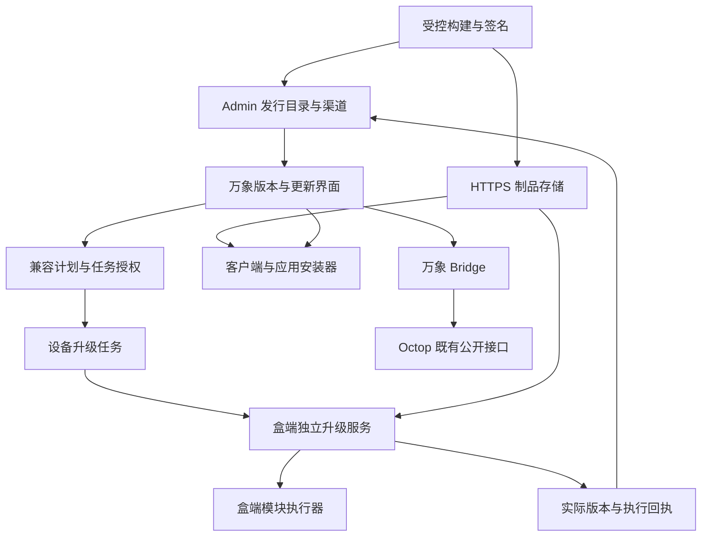

# 万象客户端 盒端 OTA 与市场应用版本管理完整方案

日期：2026-10-14

文档版本：1.0

状态：设计方案，尚未实施。适用于产品、客户端、盒端、平台和测试团队。

万象需要让用户知道自己正在使用什么版本、是否需要更新、更新会影响什么，以及失败后还能否继续使用。应用市场还需要确保客户端应用、盒端服务、专家和模型能够共同工作，避免安装成功后才发现接口、专家或授权不满足要求。

整体采用统一发行目录与兼容规则，由客户端和盒端各自完成安装、验证和恢复。**升级目标是得到经过验证的可用组合；不能仅根据版本号变大、容器启动或任务已下发判断成功。** 默认保持 Octop 源码不变，通过万象客户端、Host、Bridge、Admin 和盒端管理服务补齐能力。

## 1 范围与实施原则

### 1.1 管理对象

| 对象 | 管理内容 | 安装位置 |
| --- | --- | --- |
| 万象客户端 | 桌面程序、Host、随包运行时与网络组件 | 用户电脑 |
| 市场应用 | 知君、超级参谋团等应用包和本地数据版本 | 用户电脑 |
| 盒端软件 | base、discovery、docker、p2p、wanx、semantica 六模块及其组合 | 盒子 |
| 盒端接口 | Bridge 与业务服务的 API 合同、运行能力和健康状态 | 盒子 |
| 专家模板与实例 | 模板来源、版本、用户实例绑定和迁移状态 | 盒子 |
| 模型与索引 | 模型制品、嵌入模型及索引兼容信息 | 盒子 |
| 平台合同 | Admin 版本目录、设备管理、任务与应用授权接口 | 云平台 |

盒端不重新引入独立知君容器，也不恢复 `wanx_runtime` 包装启动层。知君应用包与盒端知君专家分别管理。一个应用可能依赖多个专家；一个模板也可能生成多个用户的私有实例。

首期不包含 Ubuntu 大版本、内核、驱动和 BIOS 升级，不开放任意第三方安装脚本，不建设通用软件包管理器。模型和专家的自动迁移以现有公开接口能够安全实现为前提。

### 1.2 Octop 实现边界

默认零 Octop 源码改动。版本查询、应用映射、兼容求解、任务管理和迁移账本由外部管理层实现；业务操作调用现有公开、受权限约束的接口。

不得通过运行时补丁、镜像内源码覆盖、直接修改 Octop 数据库结构或内部记录来替代源码改动。不得直接覆盖内置专家模板或绕过工作区接口写入用户文件。需要升级 Octop 依赖版本时，使用经过兼容验证的固定版本，并保持来源可追踪。

现有接口不能保证实例迁移、并发隔离或恢复时，保留当前实例并报告限制；先交付版本诊断和经过验证的操作路径。只有确有必要且单独评审后，才讨论最小上游接口扩展，不将其作为本方案默认依赖。

既有[商业授权方案](wanx-market-commerce-entitlements-plan.md)中关于少量修改 Octop 或进入内部权限模块的技术路径，由本节约束覆盖；其权益、订单和盒主策略原则继续适用。本方案不要求顺便回滚已有代码或迁移现存数据。

### 1.3 必须保持的规则

1. 产品版本、构建标识、发行标识、接口版本和数据版本分别管理。
2. 正式发行制品不可变；同一目标和正式产品版本不能替换成另一份字节内容冒充更新。
3. 升级前检查权限、兼容性、资源及受影响应用，执行前再次确认基线。
4. 不把版本兼容、设备访问权、软件购买权益和盒端升级权混为一项权限。
5. 首次安装配网、日常升级、修复、数据恢复和设备转让使用不同任务类型。
6. 保留账号、设备身份、用户数据和明确拒绝的授权策略。
7. 无法确认版本或结果时显示未知或待确认；不把查询失败显示成已是最新版。

## 2 当前基础与需要补齐的能力

以下为本地代码审核时的状态，不代表所有生产设备均已部署相同代码。证据入口见第 21 节。

| 环节 | 已有基础 | 需要补齐 |
| --- | --- | --- |
| 客户端版本 | 关于窗口读取程序版本；构建流程可记录源码信息 | 正式构建身份、盒端版本展示、自身更新及启动确认 |
| 市场安装 | 签名和哈希校验、分目录安装、当前与上一版本指针 | 后端及专家依赖合同、历史兼容版本分发、本地数据兼容 |
| 市场候选 | 按系统架构和最低客户端版本选择当前发布包 | 从受支持版本集合选择兼容组合 |
| 盒端发布 | 构建机固定 Git 提交、模块缓存、不可变清单和制品校验 | 发布候选与渠道推广分离、签名 OTA 元数据 |
| 盒端部署 | 分模块安装、锁、健康检查、部分回退及部署回执 | 独立升级服务、跨重启步骤恢复、统一任务状态 |
| 盒端状态 | 模块版本、镜像或服务状态等分散信息 | 目标版本与实际版本分离、完整组合核验、可信上报 |
| 专家 | 模板创建实例、已有实例复用 | 来源版本账本、用户修改识别、可验证的迁移适配器 |
| Admin | 市场制品管理、旧组件 OTA、旧 Manager 发布机制 | 新盒端发行及任务合同，与旧 OTA 路径明确区分 |

当前市场下载逻辑拒绝已经被新版本替换的制品，因此保留文件本身并不能实现兼容旧版本分发。当前应用安装器保留旧程序包，也不证明旧程序能读取更新后的本地数据。

当前完整 `box.sh deploy` 还包含接入和配网准备，不能整体作为日常 OTA 执行器。现有异常处理式容器回退也不能覆盖所有断电中断。P2P 已有部分持久事务与恢复机制，应保留并接入，不绕过已有保护。

## 3 总体架构与责任

| 组件 | 职责 | 权限边界 |
| --- | --- | --- |
| Admin | 发行目录、渠道、兼容规则、权益与升级权限、任务和审计 | 云端目录不替代设备实际状态 |
| 制品存储 | 保存不可变制品与短期下载地址 | 客户端和盒子不持有全库写权限或开发者凭据 |
| 万象客户端 | 版本展示、计划预览、发起任务、客户端及市场包安装 | 不通过客户 SSH 密码执行盒端升级 |
| Host 与 Bridge | 应用身份、接口能力查询、授权检查、专家管理适配 | 不新增 Octop 内部数据库写入 |
| 盒端升级服务 | 主动领取任务、校验、下载、安装、恢复和回执 | 独立于 wanx 业务容器，仅执行受信任模块操作 |
| box.sh | 内部构建、首次引导、指定版本部署和恢复入口 | 与升级服务共用执行核心、设备锁和状态协议 |
| 应用工程 | 声明依赖、权限、本地数据格式和升级要求 | 不自行决定商业权益或扩大盒端管理权 |

盒端控制通过设备认证的 HTTPS 拉取实现，不依赖客户端常驻，也不只依赖本次可能被更新的 P2P 通道。客户端关闭后已接收的合法任务仍可继续；状态通过平台重新获取。Bridge 可提供受权的本地只读查询，业务容器不可用时，平台展示最后上报结果和时间。

版本信息对普通用户仅返回其有权查看的盒子和应用状态。设备级兼容计算可以使用管理摘要，不能向普通成员泄露其他用户的专家内容、账号资料或应用使用记录。

## 4 版本与身份模型

### 4.1 独立版本维度

| 字段 | 用途 | 规则 |
| --- | --- | --- |
| productVersion | 给用户展示和比较的版本 | 正式客户端和市场包采用严格 SemVer |
| buildId | 区分构建与排查来源 | 不单独触发同版本自动更新 |
| releaseId | 固定一次不可变发行 | 可继续使用盒端时间戳加随机标识 |
| sourceCommits | 各源码仓库固定提交 | 记录构建时实际提交，不能仅记录 HEAD |
| artifactDigest | 识别制品字节 | 镜像还记录运行镜像摘要 |
| contractVersion | API、Host 或清单协议 | 按兼容范围协商，不与产品版本相等 |
| dataSchema | 应用或管理数据格式 | 声明可读取范围、迁移和恢复要求 |
| metadataSequence | 签名目录与渠道变更序号 | 单调递增，用于防回放 |
| securityEpoch | 指定组件的安全下限 | 按组件比较，不使用全设备最大版本代替 |

客户端版本与 Electron 版本分开展示，Electron 放入技术详情。正式产品版本由发布流程明确递增；每次构建可以自动生成 buildId，但不能把反复构建同一个 `0.1.4` 当作正式升级。

盒端新增用户可读的套件版本，与不可变 releaseId 关联。套件包含精确模块摘要和实际模块版本；未改变的模块复用原制品、保留原版本。仅渠道指针改变不产生新运行版本。

### 4.2 实际版本与目标版本

设备分别记录 `desiredReleaseId`、实际模块组合、最后完整验证发行版、最近升级任务和观测时间。只有实际受管组件组合符合某个完整发行清单，才显示对应套件版本；不按最近一次任务的 releaseId 推断整盒版本。

运行核验结合安装账本、容器镜像或系统文件摘要、正在运行的程序身份及健康探针。文件已替换但旧进程尚未重启时，分别报告“已安装版本”和“运行版本”。手动修改或未知组件返回漂移状态，不能自动补写已知版本。

缓存使用设备公钥身份，而不是 IP 或显示名称作为主键。用户切换账号、盒子转让、身份重新初始化、应用包改变或能力摘要改变时重新核验。平台保留设备观测时间和服务端接收时间，迟到上报不能覆盖较新的状态。

## 5 产品界面

### 5.1 关于万象

关于窗口展示客户端产品版本与构建标识，以及当前所选盒子的名称、实际运行套件版本和验证时间；提供“检查更新”和“版本详情”。完整交互放在“设置 → 版本与更新”，macOS 和 Windows 保持同样的信息含义。

| 场景 | 展示规则 |
| --- | --- |
| 未选择盒子 | 显示客户端版本；盒端显示尚未选择盒子 |
| 盒子在线且可核验 | 显示实际版本和当前状态 |
| 盒子离线 | 显示上次确认版本及时间，提示当前无法验证 |
| 旧盒无版本接口 | 版本信息未知，提供管理组件更新指引 |
| 部分模块更新 | 显示部分更新，详情列出已完成与未完成模块 |
| 版本组合无法识别 | 显示自定义组合或待核验，不宣称已是最新版 |
| 平台查询失败 | 保留实际版本，显示暂时无法检查更新 |
| 当前设备被灰度或支持策略限制 | 显示当前适用版本；说明更新暂未向该设备开放 |

“已是当前设备可用的最新版本”须同时具备近期目录结果、设备适配和实际版本证据。可以同时提示“应用新功能需要升级盒子”，避免把系统更新状态与单个应用的可用性混淆。

### 5.2 版本与更新中心

分为客户端、当前盒子、市场应用三个区域。每个区域展示当前版本、候选版本、更新说明、预计下载量、影响范围、是否重启和近期结果。预计耗时没有测量依据时只显示阶段和已下载字节，不提供虚假百分比或倒计时。

盒端详情展示模块实际版本、安装和运行差异、健康状态、最近任务及恢复结果。用户可复制不含令牌、密码、提示词、聊天内容的诊断摘要。运维使用同一 operationId 关联平台任务与设备日志。

更新确认页面说明哪些应用暂时不可用、是否涉及数据迁移以及谁有权限执行。普通成员可以查看结果和申请更新，不显示可直接升级整盒的可用按钮。

## 6 应用依赖与兼容计划

### 6.1 新签名清单

新增依赖通过版本化签名合同承载，不仅在原 JSON 中追加字段。现有解析器会忽略部分未知字段，旧客户端不能被视为已经执行新依赖检查。

| 声明 | 内容 |
| --- | --- |
| applicationId 与 backendProductId | 市场身份与盒端产品的可信映射 |
| clientRange 与 hostProtocolRange | 客户端、Host 支持范围，必要时含上限 |
| backendContracts | 业务 API 合同范围和必需特性 |
| requiredExperts | 稳定模板 ID、版本范围、角色、数量和必要性 |
| requiredModels | 模型类型、能力、可替代条件及资源需求 |
| requestedPermissions | 应用请求的数据和 API 权限 |
| localDataSchema | 客户端应用数据读写范围与迁移标识 |
| packageTarget | OS、架构、运行时及原生依赖条件 |
| migrationPolicy | 是否需要迁移、暂停会话及可逆性 |

将请求权限与运行能力分开：当前 `identity.read`、`http.request` 等权限声明不能同时用于表达“模型已准备好”或“支持某 API”。签名声明也不自动构成沙箱，权限仍由 Host 与服务端落实。

发行描述、包内清单与摘要必须一致，依赖和迁移策略同样在签名覆盖范围内。旧合同应用以明确测试过的兼容组合管理，不能将缺失约束解释为兼容所有后端。

升级顺序为：先让 Admin 和过渡客户端识别新合同与升级要求，再发布依赖该合同的应用。旧 candidate 接口返回旧客户端已认识的 `incompatible` 状态，不向其返回新合同的可安装候选。已有旧二进制不能凭服务端改造获得新的解析能力；旧端手工导入未知合同包时，只保证安全拒绝并保留当前安装，提示体验由过渡版本改善。候选过滤、本地导入、缓存恢复、应用回退和启动路径都要执行相应合同校验。

### 6.2 兼容范围与求解边界

第一期使用第一方应用的受控兼容表和确定性检查，不实现任意插件的通用依赖求解器。平台登记经过测试的组合，盒端提供实时运行能力与管理摘要；客户端不能仅凭版本数字大小判断兼容。

计划输入包括客户端及已安装应用、目标盒子实际组件、已登记的受管应用及专家、活跃会话、设备支持矩阵、权限和可用发行目录。后台升级需保护盒上其他用户正在使用的受管应用；客户端升级也需保护本机共享运行时中的其他应用。

存在未知旧客户端或离线盒子时不承诺全量兼容。以公开的受支持合同范围覆盖未在线客户端，并在重连时复核。未知受管依赖会阻止相关破坏性升级；非受管程序明确不在自动迁移保证范围内。

### 6.3 兼容计划

每次计划固定目标制品集合、当前基线摘要、兼容规则版本、受影响应用、步骤依赖、资源需求、维护窗口和恢复策略，并生成 planId 与计划摘要。只要目标、基线、权限范围或停机影响发生实质变化，重新计算并让用户确认。

没有共同兼容版本时保留原状，给出具体冲突。例如新超级参谋团依赖 API 3、现有知君仅支持 API 2，应选择仍受支持的旧应用包、安排经验证的联动升级，或等待兼容版本；不能自动破坏知君。

第一期每个应用在一台客户端只有一个当前版本。优先选择已知盒子的共同兼容版本；无法满足时明确列出受影响盒子。换盒子不静默降级本机应用。多版本并存及其数据隔离作为后续独立能力。

跨客户端与盒子的升级不承诺分布式原子提交。优先使用新后端兼容旧客户端的过渡版本，再更新客户端和应用，最后淘汰旧合同。不存在安全中间组合的发行，首期不进入自动更新渠道。

## 7 专家与模型生命周期

### 7.1 专家来源与实例绑定

Bridge 使用自有管理记录绑定平台账号、设备公钥身份、归属版本、市场应用、模板 ID 和专家实例 ID。盒端本地数字用户 ID 和专家名称只作本地映射或展示，不作为跨盒子身份依据。

记录模板版本、模板制品摘要、初始和最近受管内容摘要、最近迁移 ID 与结果。实例状态区分受管且未修改、用户已修改、历史来源未知、迁移中、冲突和就绪。已有同名实例不能未经核验自动登记成受管实例。

新实例按明确模板版本创建；已有实例继续保留对话、记忆、知识库、模型选择与个人设置。模板更新只改变模板，不能直接把全部用户实例版本改成新版本。

当前公开创建接口主要接受模板 slug，并不直接接受模板版本。第一期由外部受控发行目录把 slug 绑定到固定后端发行和可核验的模板摘要，创建前证实实际后端提供该模板。无法取得可靠证据时返回模板版本未知或不兼容，不能通过覆盖 Octop 内置模板或旁路导入来兑现指定版本创建。

### 7.2 迁移适配器的准入

每类专家先验证现有公开接口是否支持以下完整路径：定位准确实例、读取受管内容、隔离并发写入、获得一致恢复点、应用指定变更、回读核验、幂等恢复。普通文件覆盖接口不等同于原子迁移接口。

只更新仍匹配已知基线的受管内容；用户修改进入冲突处理。相同迁移重复执行不得重复创建专家，平台确认失败也不能导致删除后重建来冒充成功。新内容申请额外权限时先获得相应同意。

公开接口不能满足条件时，保留实例并显示需处理的具体条件。首期交付来源记录、版本诊断和新实例初始化；已有实例自动迁移仅对已通过上述验证的类型开放。

### 7.3 模型与知识库索引

模型包独立记录摘要、大小、架构、依赖、磁盘与内存要求。嵌入模型同时记录算法身份、维度、预处理和索引格式；文件下载完成不代表旧索引可继续查询。

首期保留既有模型选择，不自动更换嵌入模型，不自动重写 Octop 知识库索引。与旧索引不兼容时阻止切换，说明需要重建及资源需求。

后续仅当公开接口支持可恢复的重建、核验和切换时，开放并行准备新索引、验证后切换。失败保留旧模型与索引。清理模型前检查索引、专家、活动任务和允许回滚版本的引用；不按文件日期直接删除。

## 8 权限与应用准备

纯版本查询与兼容检查可先只读执行；产生写入前分别确认盒子访问权、软件权益、专家访问权、资源策略及相应升级权。新增付费版本的升级资格由购买条款决定，不能仅凭已购买旧版本自动授予。

| 操作 | 默认授权规则 |
| --- | --- |
| 查询版本和当前可用性 | 对应设备或应用的可见权限 |
| 安装客户端应用包 | 有效下载资格及本机操作授权，不要求盒子在线 |
| 创建个人专家 | 应用权益与盒子权限有效，且盒主允许所需资源 |
| 升级共享盒端 | 盒主或明确获授维护权限的人员 |
| 自动后台升级 | 事先设置的范围、时间和权限策略，首期默认关闭 |
| 支持人员维护 | 明确设备范围与有效期，可审计，不隐含全量权限 |

“准备并打开”的顺序为：核验登录身份和授权 → 读取实际能力 → 生成准备计划 → 确认所需操作 → 执行允许的初始化或升级 → 验证 → 建立应用会话。无权升级共享盒子的购买用户可以申请盒主更新，不应被提示再次购买。

现有免费自动授权需要明确产品、来源及仅缺失时授予的规则，保留显式拒绝。未来付费权益接入时制定迁移规则，不能将所有盒端用户默认开通全部付费应用。升级成功不产生商业权益。

已有应用以本地签名依赖和盒端实际能力检查当前可用性。版本目录故障只影响检查新版本；应用会话仍遵守现有有效期和撤销规则。长期离线授权另行设计，不能由兼容缓存代替。

## 9 客户端与市场应用更新

### 9.1 客户端自身更新

建议沿用 electron-builder 并接入 electron-updater，正式包按平台分发。Windows 使用经过验证的 NSIS 安装目标；macOS 自动更新需要应用签名及更新所需 ZIP 制品。正式发行还应完成相应平台签名与发布验证，不能把内部未签名构建直接等同客户自动更新包。[官方更新说明](https://www.electron.build/v26/docs/features/auto-update/)

流程为：检查候选 → 本机应用兼容预检 → 下载并验证 → 等待用户确认退出 → 保存任务状态 → 停止受影响应用 → 安装和重启 → 新进程验证版本及基本能力 → 记录成功。正在进行的会话先提示保存或等待，不在聊天过程中直接强制退出。

下载完成事件不代表安装成功。升级库负责的下载与安装能力不等同产品层的崩溃恢复；首期提供经过验证的修复安装包和恢复指引。正式修复通常发布更高产品版本，不能覆盖原版本制品。

保留账号、盒子列表、市场安装记录和业务数据。跨机器级与用户级安装、多个旧客户端副本、安装目录不可写等情况应明确识别，不能升级另一个目录后仍启动旧程序却报告成功。开发运行模式标注源码构建身份，不接收正式自动更新。

### 9.2 市场应用更新

保留现有签名校验、隔离准备目录和当前版本指针机制。准备新版可以在旧进程运行时完成；真正切换时撤销旧应用会话、确认旧进程停止，再启动已验证新包。失败保留当前可诊断状态，不自动无限重启。

应用包补充本地数据格式合同。切换到旧包前核验它是否可读取现有数据；保留上一包并不等于允许无条件回退。卸载或权限到期默认保留用户数据。

程序包可以共用，账号私有数据按平台账号隔离，盒子绑定数据再按稳定设备身份隔离。全局应用版本指针改变不能把一个账号的数据迁移或合并给另一账号。已有共享数据目录先识别归属，无法确认时保留并阻止自动重分配。

客户端更新与应用更新共用本机维护协调：不能在同一应用执行数据迁移时替换 Host。用户切换账号会使尚未提交的个人准备动作失效；设备级已授权升级任务按其独立规则继续，不能给新账号复用旧账号的专家或应用会话。

## 10 盒端 OTA 执行流程

### 10.1 升级服务

独立 systemd 服务使用设备自身身份领取任务和上报结果，执行器固定于任务开始时的已验证版本。仅允许受信任模块、制品类型及预定义动作；平台任务不提供任意 shell、任意写入路径或任意下载地址的执行能力。

与 `box.sh` 共享设备锁、状态格式和模块执行器。CLI 在未完成事务存在时只能查询、按规则恢复或明确接管，不能另起冲突部署。普通进程锁在重启后释放，因此必须结合持久未完成事务检查。

### 10.2 标准步骤

1. 校验任务身份、签名、目标、归属版本、支持矩阵与任务有效期。
2. 读取真实设备基线，评估依赖、活动会话、下载和解压空间、旧包保留空间以及必要模型资源。
3. 下载目标组全部必需制品；短链过期续签原制品，不重新选择 latest。
4. 验证签名、摘要、包结构和已声明依赖，确认受支持的恢复版本已在本地。
5. 等待维护时机，取得设备写锁，重新确认基线和权限，并在线确认任务及发行未撤回。
6. 持久化恢复点和即将执行的关键步骤，排空受影响业务，按验证过的顺序切换。
7. 检查实际运行版本、服务健康和本任务要求的能力；必要时按声明恢复。
8. 持久化最终结果及实际组件组合，排队上报；平台确认接收不影响已落盘结果。

磁盘不足、平台不支持、活动事务冲突或基线变化，都应在停止旧服务前返回明确状态。受影响服务必须具备可验证的排空或暂停路径；不能仅假定客户端窗口关闭就代表盒端无人使用。

日常升级不自动开启配网窗口、不重新认领、不重建设备身份、不清空授权，也不顺带停用不属于本次计划的旧应用。

### 10.3 支持矩阵与高风险组件

当前系统模块支持判断为 Ubuntu 24.04 amd64；26.04 属于显式例外放行，不能因历史安装成功直接视为正式 OTA 支持。客户端也按实际验证的平台与架构发布，不能以通用包标签代替四个平台目标的验证。

第一批盒端自动更新只开放已验证平台上的、数据向后兼容的业务服务更新。base、discovery、Docker、P2P 和升级器自身先进入内部受控测试；通过独立恢复验证后再扩大范围。业务更新若要求变更尚未开放的基础模块，应要求受控引导，不能隐式一并更新。

网络更新需本地可用的可信恢复包和独立恢复 watchdog。分别验证管理连接与应用数据通道；客户电脑离线时使用受控探测端点，不能把客户未在线当作升级失败。升级器自身采用备用可启动版本及启动确认，不能在安装其他模块期间替换正在执行的恢复逻辑。

## 11 任务状态与持久恢复

### 11.1 状态定义

| 状态 | 含义 |
| --- | --- |
| queued | 已创建，等待设备领取 |
| prechecking | 检查身份、权限、基线与资源 |
| downloading | 下载固定目标制品 |
| staged | 制品校验完成，尚未切换 |
| waiting_window | 等待用户确认、维护时间或活动任务结束 |
| applying | 正在修改受管运行状态 |
| verifying | 正在核对实际版本和必需健康条件 |
| succeeded | 目标组合与要求的运行检查均通过 |
| rolling_back | 正在恢复允许的已知状态 |
| rolled_back | 升级未成功，已验证恢复到指定旧状态 |
| failed | 未达到目标，附实际状态与是否影响现有服务 |
| needs_attention | 无法安全自动继续或恢复，需要处理 |
| cancelled | 在安全边界停止，附实际保留状态 |

等待网络、等待重新授权、平台不可达等作为等待原因记录，不能把它们混成业务失败。平台“暂时未收到上报”是观测状态，不应伪造设备的 failed 或 succeeded。

### 11.2 任务记录与重试

至少持久化 operationId、planDigest、设备身份、ownershipEpoch、目标摘要、原始基线、执行器版本、attemptGeneration、当前步骤、旧运行对象、恢复方法及事件序号。关键操作前写入意图并确保持久化，操作后记录实际证据；设备重启时先协调未完成事务与真实现场。

在相同 operationId 下重试保持固定目标。新的目标或影响范围产生新计划。相同请求的幂等键避免重复任务；重复执行不创建多份专家、反复迁移数据或叠加授权。

设备进程通过独占锁串行修改；平台任务重派还需执行代次隔离，旧执行者或迟到回执不能覆盖当前任务。基线变化返回 `PLAN_STALE` 并重算，不能沿用过期的预检结果。

### 11.3 取消与重启

下载、待执行阶段可以取消；进入切换后只记录取消请求，在已声明安全点停止或完成恢复后确认。不能直接杀死执行进程来实现即时取消。

需要重启设备的发行必须提前声明。重启前记录预期版本与启动验证条件；重启后继续同一任务并核验。只收到“已发送重启命令”不算升级成功。首期未验证的重启路径不开放自动执行。

回执上报支持重试、去重和乱序保护，至少绑定任务、执行代次、事件序号与实际状态摘要。设备已经成功但平台暂时不可达时，本地显示已完成待同步；平台显示结果待确认。

## 12 升级许可与信任

### 12.1 升级许可独立于用户会话

短期用户 SSO 和应用会话不适合覆盖长时间下载与安装。用户登录用于发起并授权任务，设备使用独立任务许可执行。许可绑定设备身份、归属版本、计划摘要、动作范围、有效期和允许的恢复范围。

首期切换前必须在线重新确认任务未撤销、归属未改变、发行未撤回。断网可以继续已有本地制品验证及在有效条件下完成已开始的下载；需要续签地址或许可时等待。进入切换后的必要一致性恢复可以离线完成。

许可到期不能开启新的危险步骤；已经进入不可中断步骤时只能完成到安全点或按固定范围恢复。完成恢复不要求重新取得原用户短期会话，也不能借此继续其他升级或业务访问。设备转让撤销尚未开始的旧维护任务，正在切换的任务先恢复一致状态，随后重新登记结果。

### 12.2 签名与轮换

SHA256 只校验字节一致性，不能替代 OTA 发行者身份验证。客户端、盒端和平台必须按版本化合同验证签名、用途、目标和摘要。发行签名、任务许可签名与商业授权签名在用途和权限上隔离。

安装信任根不能取自待安装包自身。根信任与在线发行密钥分工，元数据带 keyId、根版本、单调序号和有效期。先分发并确认新旧双信任，再切换发行密钥，最后按支持策略退役旧信任；长期离线设备保留受控的中间升级路径。

回滚限制同时检查组件安全下限和允许恢复集合。不要直接套用旧 OTA 的设备级最大 securityVersion 来比较不同模块。常规安全下限随经过验证的安装提交更新；独立安全撤销通过更高序号的可信策略生效，两者均不可因创建一个失败任务而被错误推进。

撤回发行使用新的签名元数据，保留原制品不可变。撤回阻止新激活；已开始的任务到安全点后按明确恢复政策处理。普通撤回不自动删除数据或取消购买，涉及安全禁止运行时由独立策略明确范围。

## 13 数据保护与恢复

代码回退、配置恢复、数据库恢复和专家迁移撤销分别记录。恢复旧容器后必须核验它能读取当前数据和正常提供服务，才能显示恢复成功。

首期自动更新优先限于数据向后兼容的发行。需要不可逆迁移的发行标记为维护升级，不进入默认自动渠道。迁移前排空写入，获取应用一致的恢复点，并验证恢复方法与所需空间；仅复制正在写入的数据库文件不能视为一致备份。

在新版本恢复用户写入后，恢复升级前快照可能丢失新数据。此时默认采用向前修复或经明确确认的数据恢复，不能宣传无损自动回滚。客户端应用本地数据库同样遵守该规则。

恢复范围与任务范围一致。单个应用或专家失败不得静默恢复整盒数据库，避免回退其他账号和应用的写入。确需整库恢复时，作为独立维护操作列明全部影响、停写要求和授权；缺少隔离恢复能力的类型不进入自动迁移范围。

模块执行顺序要同时保证中间组合可用。不能安全单独切换的模块构成升级组，暂停相关服务并整体核验；这不代表跨电脑、盒子和云平台具备全局原子事务。

缓存清理保留当前运行制品、允许的最近恢复版本、未完成事务引用和受支持旧客户端所需制品。备份含用户数据时保存权限与保留周期分别管理，诊断上报不上传备份内容。

## 14 发行目录 渠道与 Admin 整合

### 14.1 发行与推广规则

发行从草稿、已验证、可推广到暂停或撤回，渠道使用 internal、beta、stable 等明确名称。构建上传与渠道推广分开：`box.sh publish` 的未来职责为产生可验证候选，客户可见渠道由平台审核和推广控制。现有 publish 自动更新渠道的行为需要迁移适配，不能只改产品文案。

兼容目录保留推荐、仍受支持、停止分发和已撤回版本。候选与下载接口都允许经过授权的受支持历史制品；不能只修改候选查询却仍拒绝其下载。正常停止新销售与停止已有用户下载、升级资格是不同商业决策。

渠道推广使用条件更新及单调序号，避免 home 与 office 并行构建或旧任务重试把新指针覆盖。任务一旦创建固定其目标，渠道变化不导致下载途中换版本；安装前再检查目标是否被撤回。

客户升级选择优先级是：权益与设备范围有效 → 平台及架构支持 → 全部必要依赖兼容 → 数据迁移政策允许 → 渠道和灰度允许 → 选择适用版本。不能简单取全局最大版本。

完整构建记录包含各仓库固定提交、依赖锁、构建配方、基础镜像摘要和验收记录。构建号自动生成不代替产品版本管理；未提交的本地代码不得被发布记录写成某个干净 Git 提交的正式制品。

### 14.2 现有后台的整合决策

采用“统一管理入口、复用成熟基础能力、新执行协议独立实现”的方式。可以重做现有页面布局和交互，保留历史数据、验签与权限审计能力。不能直接删除旧表，也不能只给旧组件 OTA 增加六个模块名称就用于新盒子。

| 现有入口 | 当前实际职责 | 新方案去向 |
| --- | --- | --- |
| 设备运维中的 OTA 版本 | 旧组件发行登记、预检、双人分权发布；远程下发主要针对 Token 和 Remote Agent | 统一发行中心的旧组件分类，保留原始版本与合同 |
| 升级任务 | 旧任务列表、详情和可信事件；当前页面没有完整的新盒创建和取消流程 | 重做任务中心，按协议类型展示可用操作及原始证据 |
| 整机版本管理 | 旧 Manager repository 的导入、审查、独立签名批准、上传和公开候选 | 标记为旧版整机发行，新六模块建立盒端套件分类 |
| 应用市场 | 应用目录、发行、制品上传验签、按目标维护稳定发布指针 | 保留目录和商业职责，关联统一发行及兼容信息 |
| 设备列表与 OTA 概览 | 身份、在线与旧组件库存、近期任务 | 扩展为实际盒端组合、OTA 就绪、应用能力与任务入口 |

建议最终“版本与升级中心”提供发行目录、渠道与兼容、升级任务、设备版本四个页面，旧发行与旧任务通过筛选或历史档案查看。发行目录区分万象客户端、盒端套件、市场应用和旧组件；专家与模型在相关能力开放后作为独立制品类型加入。

应用市场继续管理应用资料、上下架及后续商品权益。查看应用发行时跳转或引用同一 release/artifact，不再建立第二套商品库或重复可编辑发布状态。客户端安装包和盒端套件不伪装成可购买的市场应用。

### 14.3 复用内容与新建边界

复用现有制品上传会话、不可变指纹预检、验签、角色权限框架、操作审计和可靠事件机制。旧 OTA 已有创建人不得审批自己发行的规则，新客户端和盒端套件的正式渠道推广应保留同等分权控制。市场目前没有同样的双人审批流程，若纳入统一治理需明确新增规则，不能声称已经具备。

2026-10-15 用户补充授权：测试时允许自己审批自己。实现为服务器侧默认空的精确发行 ID 许可，测试操作者仍正常登录并具备推广权限，签名、有效期、渠道和 revision 检查保持；审计记录实际操作者及 `test-self-approval`。不新增客户端绕过参数，不使用通配符。此次家庭试点仅放行固定测试发行，推广后已移除配置；正式渠道仍按上述分权流程执行。

新任务所需的计划基线、归属版本、恢复步骤、执行代次和真实模块证据使用独立版本化实体。旧 `nexus_ota_*`、`nexus_manager_*`、`nexus_market_*` 记录保留原含义，通过适配查询关联。新套件不能沿用旧 Manager 的批准签名；旧签名仅证明原始合同和摘要。

新盒端采用独立执行协议、设备能力声明、许可用途及路由。旧 Gateway OTA 的组件白名单继续保留；旧 Manager 设备任务中的只读 CHECK 不被当作新版安装 APPLY。旧 `committed` 状态不能自动解释为新六模块全部已验证。

旧后台查询权限可以按角色显式迁移，新发行推广、设备升级、取消和恢复分别授权。拥有旧 OTA 管理权限不自动获得所有新盒子的控制权。统一任务页面必须按实际协议提供按钮，不向旧任务发送新版取消或恢复命令。

### 14.4 迁移与退役次序

1. 清点旧版本、设备、任务和调用方，建立原始记录到统一展示的映射。
2. 新旧查询并行，先交付统一列表和只读详情；新设备接入新升级服务。
3. 新合同试点通过后开放新版发行和任务，按记录来源明确分流。
4. 对已经迁移的范围停止旧流程新建，继续接收旧任务事件并允许其必要恢复。
5. 未完成旧任务已终结或有明确移交，旧设备均完成迁移、退役或进入有期限的维护名单后，关闭相应旧执行入口。
6. 确认没有受支持旧调用方后移除旧可写页面；查询、审计和必要恢复制品按保留政策归档。

最近没有请求不能独立证明长期离线设备已无依赖。页面重做和代码退役不要求删除版本记录；数据库物理删除需另外制定保留与迁移计划，不属于本方案当前交付。

## 15 数据实体与接口合同

### 15.1 建议新增或扩展的实体

| 实体 | 核心内容 |
| --- | --- |
| Release 与 Artifact | 产品版本、固定制品、来源、依赖、迁移策略及签名 |
| ChannelPromotion | 渠道、发行目标、单调修订、操作者与撤回记录 |
| CompatibilityPolicy | 受支持合同、平台矩阵和经过验证的组合 |
| DeviceInventory | 设备身份、运行组件摘要、能力、健康与观测时间 |
| UpgradePlan | 基线、固定目标、影响分析、依赖步骤和恢复策略 |
| UpgradeOperation | 幂等键、授权主体、状态、执行代次、设备结果 |
| UpgradeEvent | 单调序号、步骤、重试原因和脱敏证据 |
| ManagedExpertBinding | 账号及盒子绑定、模板来源、实例基线和迁移状态 |
| AppReadiness | 指定账号、盒子和应用的兼容、授权、资源就绪结果 |

发行目录是期望状态的来源，设备报告是实际状态的来源，商业权益服务是购买资格的来源。三者不能互相替代。专家管理账本存放在 Bridge 自有存储，不扩展 Octop 内部表。

统一后台查询模型增加 `sourceKind`、`sourceRecordId` 和 `contractVersion`，关联旧 OTA、旧 Manager 和市场记录。展示层可以归类，但保存原始状态、签名和执行证据；不批量改写旧记录为新版套件或新版任务。

### 15.2 建议接口能力

下列为待实现的逻辑合同，不是现有 URL 或可立即执行的命令。

| 能力 | 输入重点 | 输出重点 |
| --- | --- | --- |
| 查询客户端候选 | 当前产品和构建、OS 架构、运行时及已装应用摘要 | 候选或阻塞原因、签名发行描述 |
| 查询盒端实际版本 | 经验证设备身份、请求者权限 | 运行组件、套件匹配、健康、证据时间 |
| 查询应用就绪状态 | 账号、盒子、应用制品和合同版本 | 权限、接口、专家、模型的分别状态 |
| 生成升级计划 | 实际基线、目标意图、渠道和支持策略 | 固定计划、影响范围、需要的授权 |
| 创建或取消任务 | 幂等键、计划摘要、确认范围 | operationId、状态或取消待完成 |
| 设备领取与续期 | 设备身份、执行代次、待恢复状态 | 固定任务、许可及短期制品下载授权 |
| 上报执行事件 | 任务、代次、序号、运行证据 | 去重确认及后续指令 |
| 专家来源与迁移 | 受权实例绑定、目标模板及基线 | 保留、就绪、冲突或迁移结果 |

错误合同至少区分 `PLAN_STALE`、`UPDATE_IN_PROGRESS`、`UNSUPPORTED_PLATFORM`、`CONTRACT_UNSUPPORTED`、`DEPENDENCY_CONFLICT`、`EXPERT_VERSION_UNKNOWN`、`MODEL_INDEX_INCOMPATIBLE`、`INSUFFICIENT_SPACE`、`UPDATE_PERMISSION_REQUIRED`、`APP_ENTITLEMENT_REQUIRED`、`RELEASE_WITHDRAWN` 和 `RECOVERY_REQUIRED`。这些是建议代码，不应在实现前当作已有服务返回值。

版本、任务和授权合同各自演进。新增必需字段通过新协议版本或关键扩展明确拒绝旧实现；不能让旧客户端静默忽略。API 范围与制品的兼容范围需要一起验证。

## 16 首次引导与存量迁移

现有盒子需要一次受控 `box.sh` 引导，安装独立升级服务、信任根、设备认证、实际版本上报和恢复机制。引导保留现有身份、数据和认领关系；新盒的首次配网仍由首次安装流程负责。

引导后必须验证设备能独立领取测试任务、上报真实状态、重启后恢复服务及拒绝未授权任务，再标记为 OTA 就绪。Admin 的 P2P 在线状态、运维在线状态和 OTA 就绪状态分别呈现。

旧发行清单按来源和实际摘要映射为历史版本，不伪造新的签名历史或专家模板版本。无法识别的组件先记录未知；存在可信映射后再补充解释。未知 OS、架构或显式例外放行设备只开放版本诊断，进入验证名单后才能推广 OTA。

升级器协议升级需要可理解新协议的过渡版本，避免“必须先升级才能理解这次升级任务”的死循环。客户无需配置 Git、SSH 或广泛的 MinIO 凭据。

## 17 实施阶段与交付门槛

| 阶段 | 交付内容 | 依赖与退出条件 |
| --- | --- | --- |
| P0 合同与可行性 | 版本和依赖 schema、设备证据合同、任务状态、权限边界、专家适配器验证 | 冻结第一方应用支持矩阵，证明无需修改 Octop 的可行路径；不可行能力明确暂缓 |
| P1 版本可见与判断 | 关于和更新中心、运行版本上报、应用准备诊断、兼容历史目录、Admin 新旧统一只读视图 | 旧盒和未知版本不误报；客户端及盒端查询一致；历史合同和记录保持；此阶段不开放自动安装 |
| P2 受控升级闭环 | 正式客户端更新、市场包兼容检查、盒端已验证业务模块升级、任务许可与持久恢复 | 先安装升级器；签名、重试、断电恢复、权限、数据兼容均通过；用户逐次确认 |
| P3 扩展与运营 | 经验证的专家迁移、基础网络模块、自升级、灰度批量、维护窗口及旧流程退役 | 每一类升级单独通过恢复准入；旧流程达到第 14 节门槛后退役 |

P2 不默认更换嵌入模型，不自动迁移来源未知专家，不运行不可逆数据迁移，也不自动升级 P2P、Docker 或操作系统。需要这些前置更新时显示受控升级路径。

P2 的客户端更新与盒端业务更新可在合同冻结后并行开发，整体验收必须覆盖组合。P3 的模型索引迁移只有公开接口支持时另行纳入；没有接口时保留受支持人工操作路径。

## 18 工程拆分与预计涉及位置

以下为实施时的职责定位，不表示本次已修改这些文件。

| 工程 | 主要位置 | 交付职责 |
| --- | --- | --- |
| centuarai-wanx | wanx-client/shell、applications、Host、设置界面 | 关于页、更新中心、客户端安装、清单合同、依赖检查与本机协调 |
| centuarai-wanx | wanx-bridge/wanx_bridge | 只读版本和能力适配、专家来源账本、受权准备与迁移适配器 |
| centuarai-os | scripts/fleet.py、scripts/boxlib、deployment | 发布与推广分离、安装和日常更新模式、共享执行器、实际证据与恢复 |
| centuarai-os | 新增独立升级服务及其配置 | 设备认证、任务领取、锁、持久状态、恢复和上报 |
| nexusaos-admin | module_nexus 市场、发行、设备管理与前端 | 兼容目录、计划、任务、升级权限、审计及批量控制 |
| 知君和超级参谋团等 | market 清单、Host 接入及本地数据管理 | 依赖声明、稳定专家映射、数据兼容和错误引导 |

Admin 既有 Remote OTA 与旧 Manager 发布协议不直接改名复用为新盒端协议。可以复用权限、审计、可靠事件等基础设施，但为新模块清单和设备执行证据制定独立合同，防止错误投递。

## 19 验收矩阵

| 编号 | 场景 | 必须满足的结果 |
| --- | --- | --- |
| V01 | 同一客户端版本有多个开发构建 | 显示不同构建身份，不伪装正式升级 |
| V02 | 部分模块更新或手工替换镜像 | 不显示完整套件已升级；能定位差异 |
| V03 | 盒子离线、版本平台不可达、上报迟到 | 缓存带时间，状态不倒退，不误报最新版 |
| V04 | 切换盒子、账号或设备归属 | 版本和专家缓存重新校验，不跨身份复用 |
| C01 | 旧客户端接收新清单、本地导入或回退 | 明确要求升级，不忽略必需依赖 |
| C02 | 一应用要求新 API，另一应用要求旧 API | 阻止冲突更新，展示受影响应用 |
| C03 | 新旧两台盒子共用一个本机应用 | 有共同版本时选择兼容包；否则明确限制 |
| C04 | 新包上架但旧盒仍需支持版本 | 合法旧版本可查询和下载；撤回版本不可新激活 |
| C05 | 客户端运行时更新 | 已安装应用在各正式平台实际启动验证通过 |
| E01 | 专家改名、用户改提示词、来源未知 | 不按名称猜测版本，不覆盖用户内容 |
| E02 | 相同本地用户 ID 出现在不同盒子 | 实例绑定和权限完全隔离 |
| E03 | 专家迁移中断或重复请求 | 恢复或保留原实例，不重复创建、不假报成功 |
| E04 | 更换嵌入模型与旧索引不兼容 | 首期阻止切换；旧知识库继续使用原模型 |
| A01 | 已买应用但无盒端升级权 | 保留权益，申请盒主更新，不重复收费 |
| A02 | 盒主无付费应用权益或明确拒绝应用 | 不能由升级或免费初始化绕过权限 |
| A03 | 新版本新增敏感权限 | 使用新权限前取得同意 |
| A04 | 应用会话过期但设备升级仍在执行 | 应用按规则失效，合法升级和必要恢复不被短会话打断 |
| U01 | 下载断网、短链过期、空间不足 | 旧服务保持可用，重试保持同一制品摘要 |
| U02 | CLI 与 OTA 同时修改、平台重复派单 | 只有一个有效执行者，重启先处理未完成事务 |
| U03 | 停旧容器后、新容器启动前断电 | 启动后按持久步骤恢复；核验后才报告成功或恢复 |
| U04 | 预检后设备状态或所有者改变 | 切换前阻止旧计划，重算或撤销 |
| U05 | 用户在不同阶段点击取消 | 下载可取消；切换阶段到安全点才确认 |
| U06 | 设备完成而平台断网、乱序回执 | 本地结果持久；补报去重，旧代次不覆盖新结果 |
| U07 | 客户端关窗或退出、设备需重启 | 已授权设备任务持续或恢复，正确报告最终运行版本 |
| R01 | 旧程序无法读取迁移后数据 | 不盲目回退旧包，转入前向修复或明确恢复流程 |
| R02 | 新版恢复写入后尝试旧快照 | 明示数据恢复影响，不自动宣称无损回滚 |
| S01 | 制品被改、身份不匹配、旧元数据重放 | 安装前拒绝，现有运行保持 |
| S02 | 密钥轮换、允许回滚、安全撤销 | 遵守根信任与组件安全下限，不按全设备最大版本误判 |
| S03 | home 与 office 并行推广、旧任务重试 | 渠道不被过期操作覆盖，运行任务目标不漂移 |
| S04 | 26.04、arm64 或未验证平台 | 先诊断，不因历史例外安装成功开放正式 OTA |
| B01 | 日常更新已认领盒子 | 不重新配网、认领、生成身份或覆盖拒绝授权 |
| B02 | 旧 OTA 和 Manager 数据进入统一后台 | 保留原合同及证据，旧 committed 不被标为新套件验证成功 |
| B03 | 停止旧流程新建但仍有旧任务 | 继续接受回执和必要恢复，不删除旧版本及任务 |
| B04 | 旧权限角色和旧签名用于新套件 | 不自动授予新盒控制权，不把旧批准转换为新批准 |
| D01 | 多账号共用本机应用或整盒数据库 | 程序更新不混合私有数据；局部失败不静默回退整库 |

发布门槛包括单元和合同测试、客户端 macOS 与 Windows 的真实安装包升级、盒端故障注入与恢复，以及知君和超级参谋团的真实组合验收。健康验证先用只读检查或明确隔离的测试数据，不默认发送用户内容或产生付费模型调用。

## 20 运行策略与待确认事项

### 20.1 建议默认策略

首期只提供手动确认更新，后台可检查；下载是否自动由用户设置控制。更新检查采用有抖动的间隔和失败退避，不在每次打开应用时串行等待云端版本查询。用户可以固定受支持版本，平台显示安全和支持状态，不静默跨越重大迁移。

保留至少一个经过验证、仍允许回滚的版本，以及全部未完成任务依赖。兼容制品、模型和索引按引用关系清理，具体数量与天数结合设备容量和支持期限确定。

灰度按稳定设备或安装身份分组，先内部设备再测试客户再稳定渠道。分别监控下载失败、安装失败、恢复率、启动失败、应用就绪失败和结果待确认，不能仅统计 HTTP 成功率。出现身份丢失、用户数据损坏或权限扩大即暂停推广；一般失败阈值和观察时长在试点实测后配置。

### 20.2 需要业务或实施阶段明确的政策

| 项目 | 建议默认值 | 确认时点 |
| --- | --- | --- |
| 正式支持平台 | 已验证的 macOS 和 Windows 目标；盒端先 Ubuntu 24.04 amd64 | P0 冻结矩阵 |
| 客户端与盒端支持周期 | 明确版本区间和停止支持日期，不承诺无限兼容 | 首次稳定推广前 |
| 买断包含的升级范围 | 由权益条款给出，技术保留版本范围判定 | 付费版本上架前 |
| 企业维护权限 | 显式设备范围、操作者及期限 | 企业 OTA 开放前 |
| 自动更新与维护窗口 | 默认人工确认，后续由盒主设置 | P3 开放前 |
| 恢复包与备份保留 | 先保证当前、允许恢复和任务依赖，容量不足阻止升级 | P2 试点前 |
| 专家和索引迁移 | 公开 API 能力不足时保留现状，不修改 Octop 绕开 | P0 可行性验证 |

这些政策不阻碍先交付真实版本展示、兼容合同和受控升级验证；未确认的商业或破坏性行为保持关闭。

## 21 依据与关联文档

### 21.1 本地实现入口

- [客户端关于窗口](../wanx-client/shell/desktop.mjs)：目前只配置客户端版本。
- [市场清单解析](../wanx-client/applications/manifest.mjs)与[签名描述校验](../wanx-client/applications/descriptor.mjs)：现有协议与依赖扩展边界。
- [市场安装器](../wanx-client/applications/installer.mjs)：当前版本、上一版本和本地数据路径。
- [知君初始化](../wanx-bridge/wanx_bridge/zhijun_bootstrap.py)与[知识库初始化](../wanx-bridge/wanx_bridge/knowledge_bootstrap.py)：实例复用和已有模型保留。
- [应用初始化授权](../wanx-bridge/wanx_bridge/application_bootstrap.py)：现有免费应用策略与显式拒绝保留。
- [盒端发布和部署核心](../../centuarai-os/scripts/boxlib/remote.py)：清单、渠道、模块状态、部署和锁。
- [盒端部署编排](../../centuarai-os/scripts/fleet.py)：接入、安装和配网准备的当前关系。
- [容器执行器](../../centuarai-os/deployment/app_modules.py)、[系统平台检查](../../centuarai-os/deployment/system_modules.py)与[P2P 事务](../../centuarai-os/deployment/netbird_transaction.py)：当前健康、平台限制和恢复基础。
- [Admin 市场服务](../../../nexusaos/nexusaos-admin/admin-backend/module_nexus/service/nexus_app_market_service.py)：当前候选指针与旧制品下载限制。
- [Admin 既有 OTA 投递](../../../nexusaos/nexusaos-admin/admin-backend/module_nexus/service/nexus_ota_delivery_service.py)：旧组件任务的协议边界。
- [Admin OTA 页面接口](../../../nexusaos/nexusaos-admin/admin-frontend/src/api/nexus/ota.js)与[旧整机版本页面](../../../nexusaos/nexusaos-admin/admin-frontend/src/views/nexus/ota/manager-release/index.vue)：现有管理入口。
- [旧 Manager 发行合同](../../../nexusaos/nexusaos-admin/docs/contracts/manager-release-api.md)与[旧 Manager 设备检查](../../../nexusaos/nexusaos-admin/admin-backend/module_nexus/service/nexus_manager_job_service.py)：旧整机发行和只读检查的实际范围。
- [旧 OTA 退役策略](../../../nexusaos/nexusaos-admin/admin-backend/module_nexus/ota_policy.py)：停止新任务与保留历史回执的现有机制。

### 21.2 产品与运维文档

- [万象应用商店交易与应用授权实施方案](wanx-market-commerce-entitlements-plan.md)。本方案第 1 节规定当前 Octop 实现边界。
- [WANX 应用市场开发与发布](wanx-application-market.md)。
- [盒端统一部署说明](../../centuarai-os/docs/fleet-deployment.md)。
- [万象手工发布与新盒子部署](../../centuarai-os/docs/wanx-release-deployment.md)。具体接入行为以当前代码及任务模式为准。
- [electron-builder 自动更新官方说明](https://www.electron.build/v26/docs/features/auto-update/)。用于客户端更新机制和平台制品要求。
